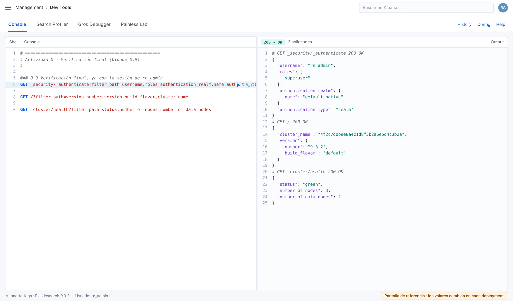

# Actividad 0 · Preparación del entorno en Elastic Cloud Hosted

| | |
|---|---|
| **Duración** | 30 minutos |
| **Entorno** | Consola de Elastic Cloud (cloud.elastic.co) y Kibana › Dev Tools |
| **Archivos que usarás** | `cap00/lab00-preparacion.txt` (comandos) · `cap00/registro-deployment.md` (registro) |
| **Requisitos** | Correo electrónico válido y navegador actualizado (Chrome, Edge o Firefox) |
| **Deja listo para** | Todos los laboratorios del curso |

---

## Objetivo

Crear el deployment **`rutanorte-logs`** de Elasticsearch y Kibana en Elastic Cloud Hosted. Además:
- dominar la Console de Kibana Dev Tools, que es el entorno donde ejecutarás todos los comandos del curso;
- crear un usuario personal de laboratorio;
- verificar que la plataforma responde con la versión y el estado esperados.

## Contexto

La dirección de RutaNorte aprobó centralizar los logs de sus seis servicios en Elastic Cloud Hosted. Antes del primer evento de log hace falta lo más básico: **un lugar donde vivan los datos y una forma segura de administrarlos**.

En ECH, Elastic opera la infraestructura: las máquinas, el sistema operativo, la instalación de Elasticsearch, los certificados TLS y la alta disponibilidad entre zonas. RutaNorte, es decir tú, decide lo demás: la región, el tamaño, la versión, quién entra y cómo se organizan los datos. Esta actividad es tu primera decisión de plataforma.

## Qué vas a hacer

| Paso | Actividad | Dónde |
|---|---|---|
| 0.1 | Entrar o registrarte en Elastic Cloud | cloud.elastic.co |
| 0.2 | Crear el deployment `rutanorte-logs` | Consola de Elastic Cloud |
| 0.3 | Revisar y registrar los datos del deployment | Consola de Elastic Cloud |
| 0.4 | Abrir Kibana y ubicar Dev Tools | Kibana |
| 0.5 | Conocer la Console y ejecutar la primera solicitud | Kibana › Dev Tools |
| 0.6 | Consultar la salud del clúster | Kibana › Dev Tools |
| 0.7 | Identificar con qué usuario trabajas | Kibana › Dev Tools |
| 0.8 | Crear el usuario personal `rn_admin` | Kibana › Dev Tools |
| 0.9 | Entrar como `rn_admin` y verificar el entorno | Kibana › Dev Tools |

---

## Paso 0.1 · Entrar a Elastic Cloud

**Qué estás haciendo.** Obtienes acceso a la consola de Elastic Cloud, el portal donde se crean y administran los deployments. Es distinto de Kibana: la consola administra la *infraestructura*, Kibana administra los *datos*.

1. Abre <https://cloud.elastic.co> en el navegador.
2. Inicia sesión con la cuenta asignada. 
3. Si el asistente de bienvenida te pregunta por el caso de uso, elige **Elasticsearch**.

> **Prueba gratuita.** Dura 14 días y permite **un deployment activo a la vez**. Cuando la prueba venza, el deployment se suspende y hay 30 días para suscribirse antes de que se borre.

## Paso 0.2 · Crear el deployment `rutanorte-logs`

**Qué estás haciendo.** Un *deployment* en ECH es un clúster de Elasticsearch más su instancia de Kibana (y, opcionalmente, otros componentes como Integrations Server o nodos de machine learning). Al crearlo eliges dónde corre, con qué perfil de hardware y en qué versión.

> **Cuidado: Hosted, no Serverless.** Elastic Cloud ofrece dos modelos. **Elastic Cloud Hosted** te da un clúster con nodos, shards y versión visibles, que es lo que estudia este curso. **Serverless** oculta esa capa. Asegúrate de crear un **Hosted deployment**.

1. En la página de inicio de la consola, haz clic en **Create deployment** (puede aparecer como **Create hosted deployment**). Si te ofrece elegir entre *Serverless project* y *Hosted deployment*, elige **Hosted deployment**.
2. Llena los campos:

| Campo | Valor para el laboratorio | Por qué |
|---|---|---|
| **Name** | `rutanorte-logs` (agrega tus iniciales si comparten organización, por ejemplo `rutanorte-logs-mg`) | Es el nombre que usan todas las guías |
| **Cloud provider** | AWS, Google Cloud o Azure (cualquiera) | En ECH las funciones son las mismas; cambian las regiones y el precio |
| **Region** | La más cercana a ti. Desde México: `us-east-1` (AWS, N. Virginia) o `us-central1` (GCP, Iowa) | Menor latencia y, en producción, cumplimiento de residencia de datos |
| **Hardware profile** | **General purpose** (puede llamarse *CPU optimized* según la región; ambos sirven) | Balance de CPU, memoria y disco adecuado para logs de laboratorio |
| **Version** | **9.3.x** si aparece en la lista. Si no, la versión 9.x más reciente | El curso es de 9.3. Los comandos de las guías también funcionan en versiones 9.x posteriores |

3. Haz clic en **Advanced settings** (o **Edit settings**) solo para *observar*, sin cambiar nada. Verás el tier *Hot* con el tamaño por zona y el número de zonas (en la prueba, **2 zonas**). Regresa sin modificar.
4. Haz clic en **Create deployment**.
5. **Momento crítico:** aparece una ventana con la contraseña del usuario `elastic`. **Solo se muestra una vez.** Haz clic en **Download** para descargar el archivo `.csv` con las credenciales y guárdala en tu gestor de contraseñas.
6. Espera de 3 a 7 minutos mientras ECH aprovisiona los nodos. La barra de progreso termina con el estado **Healthy**.

> **¿Qué pasa si no guardaste la contraseña?** En la consola, entra a *Deployment* › *Security* › **Reset password**. Se generará una nueva contraseña para `elastic`.

## Paso 0.3 · Revisar y registrar los datos del deployment

**Qué estás haciendo.** Documentas desde el día uno los datos que necesitarás para conectar agentes, aplicaciones y otros clústeres. En el Lab 2 convertirás este registro en la ficha de inventario oficial.

1. En la consola, haz clic en el nombre del deployment para abrir su página **Overview**.
2. Abre `cap00/registro-deployment.md` y llena la tabla con:
   - **Endpoints de Elasticsearch y Kibana:** usa el ícono *Copy endpoint*. Ambos usan HTTPS en el puerto 443.
   - **Cloud ID:** cadena codificada que contiene los endpoints. Elastic Agent, Beats y Logstash pueden usarla para conectarse sin escribir URLs.
   - **Región, versión y perfil de hardware.**
3. En el menú lateral del deployment, entra a **Manage** › **Edit** y registra el número de zonas y la memoria por zona del tier Hot. Sal **sin guardar cambios**.

| Concepto en la consola | Qué significa |
|---|---|
| **Hot tier · N zones · X GB RAM** | Nodos de datos que reciben la escritura y las búsquedas recientes, repartidos en N zonas de disponibilidad |
| **Kibana · X GB RAM** | Instancia de Kibana administrada por Elastic |
| **Integrations Server** | Componente para Fleet y APM (lo verás en el capítulo de ingesta) |
| **Tiebreaker** | Nodo pequeño, solo con voto de maestro, que ECH agrega en una tercera zona cuando el clúster usa dos zonas. Evita empates en la elección del maestro |

## Paso 0.4 · Abrir Kibana y ubicar Dev Tools

**Qué estás haciendo.** Entras a Kibana, la interfaz desde la que ejecutarás todos los laboratorios.

1. En la página **Overview** del deployment, haz clic en **Open** junto a Kibana. ECH inicia sesión por ti con tu cuenta de Elastic Cloud (SSO).
2. Si aparece la pantalla de bienvenida, elige **Explore on my own**.
3. Abre el menú principal (☰, arriba a la izquierda), baja hasta **Management** y haz clic en **Dev Tools**. También puedes escribir *Dev Tools* en la barra de búsqueda global de Kibana.
4. Si aparece un recorrido introductorio de Console, ciérralo.

## Paso 0.5 · Conocer la Console y ejecutar la primera solicitud

**Qué estás haciendo.** Console es un cliente de la API REST de Elasticsearch integrado en Kibana. Envía las solicitudes **a través de Kibana** con la identidad con la que iniciaste sesión, así que no necesitas URL, puerto ni credenciales en cada comando.

**Partes de la Console**

| Elemento | Para qué sirve |
|---|---|
| Panel izquierdo (editor) | Escribes o pegas solicitudes: método (`GET`, `PUT`, `POST`, `DELETE`), ruta y, si aplica, cuerpo JSON |
| Panel derecho (respuesta) | Muestra el código HTTP, el tiempo de respuesta y el JSON de respuesta |
| ▶ (o **Ctrl/Cmd + Enter**) | Envía la solicitud donde está el cursor |
| Ícono de llave inglesa | Copiar como `curl`, abrir la documentación del endpoint o aplicar sangría automática |
| **History** | Solicitudes ejecutadas anteriormente |
| **Config / Settings** | Tamaño de fuente, ajuste de línea y autocompletado |
| `#` al inicio de línea | Comentario: Console lo ignora |

**Ejecuta.** Copia el bloque **0.5** de `cap00/lab00-preparacion.txt`:

```
GET /
```

| Parte | Significado |
|---|---|
| `GET` | Método HTTP de lectura: no modifica nada |
| `/` | Raíz del clúster. Devuelve la identificación del nodo que atendió la solicitud y la versión |

**Resultado esperado** (los valores cambian en cada deployment):

```json
{
  "name": "instance-0000000001",
  "cluster_name": "4f2c7d0b9e8a4c1d8f3b2a6e5d4c3b2a",
  "cluster_uuid": "q3W9xY1zT8uKpL2mN4oB7A",
  "version": {
    "number": "9.3.2",
    "build_flavor": "default",
    "build_type": "docker",
    "lucene_version": "10.3.2",
    "minimum_wire_compatibility_version": "8.19.0",
    "minimum_index_compatibility_version": "8.0.0"
  },
  "tagline": "You Know, for Search"
}
```

Observa tres cosas:
- `name`: en ECH los nodos se llaman `instance-00000000NN`, no con los nombres que tú elijas.
- `cluster_name`: es el ID interno del clúster, no el nombre `rutanorte-logs`.
- `version.number`: es la versión de tu deployment. Anótala en el registro.

## Paso 0.6 · Consultar la salud del clúster

**Qué estás haciendo.** Antes de trabajar sobre un clúster, el primer hábito de un operador es preguntar si está sano.

Ejecuta el bloque **0.6**:

```
GET _cluster/health
```

| Campo de la respuesta | Qué indica | Valor esperado hoy |
|---|---|---|
| `status` | `green`: todos los shards asignados. `yellow`: falta alguna réplica. `red`: falta algún primario | `green` |
| `number_of_nodes` | Nodos en el clúster, incluido el tiebreaker si existe | 2 o 3 |
| `number_of_data_nodes` | Nodos que guardan datos | 2 en la prueba de 2 zonas |
| `active_shards_percent_as_number` | Porcentaje de shards activos | 100.0 |

> Aunque todavía no creas índices, verás shards activos: son los **índices de sistema** de Kibana y de seguridad (nombres que empiezan con punto).

## Paso 0.7 · Identificar con qué usuario trabajas

**Qué estás haciendo.** Confirmas la identidad que Console usa para enviar tus solicitudes. Esta respuesta es tu primera evidencia de seguridad.

Ejecuta el bloque **0.7**:

```
GET _security/_authenticate
```

Al entrar desde la consola de Elastic Cloud verás un usuario asociado a tu cuenta de Elastic Cloud (realm de tipo `saml`, por ejemplo `cloud-saml-kibana`) o, si entraste con usuario y contraseña, `elastic` con el realm `reserved`. Revisa también el campo `roles`.

## Paso 0.8 · Crear el usuario personal `rn_admin`

**Qué estás haciendo.** El usuario `elastic` es el superusuario de emergencia del deployment. Usarlo en el día a día es una mala práctica: es compartido, no deja claro quién hizo qué en la auditoría y, si se filtra, compromete todo. Por eso creas un usuario nominal de laboratorio. En el Lab 7 lo cambiarás por roles de mínimo privilegio.

Ejecuta el bloque **0.8** después de **cambiar la contraseña** por una propia:

```
POST _security/user/rn_admin
{
  "password": "CambiaEstaClave-2026!",
  "roles": [ "superuser" ],
  "full_name": "Administrador de laboratorio RutaNorte",
  "email": "rn_admin@rutanorte.example",
  "metadata": {
    "proyecto": "rutanorte-logs",
    "creado_en": "actividad-0"
  }
}
```

| Parámetro | Explicación |
|---|---|
| `POST _security/user/rn_admin` | Crea (o actualiza) el usuario `rn_admin` en el realm nativo del clúster |
| `password` | Contraseña del usuario. Mínimo 6 caracteres; en producción, sigue la política de la empresa |
| `roles` | Roles asignados. `superuser` es un rol integrado con todos los privilegios. Aquí se acepta porque es un laboratorio; en el Lab 7 crearás roles a la medida |
| `full_name`, `email` | Datos descriptivos que aparecen en Kibana y en la auditoría |
| `metadata` | Pares clave-valor libres para documentar el origen del usuario |

**Resultado esperado:** `{ "created": true }`. Si repites el comando, verás `"created": false`, porque el usuario se actualizó en lugar de crearse.

Ejecuta el bloque **0.8b** (`GET _security/user/rn_admin`) para comprobar sus datos. La respuesta **no** incluye la contraseña.

## Paso 0.9 · Entrar como `rn_admin` y verificar el entorno

**Qué estás haciendo.** Compruebas que el usuario nuevo funciona y dejas el entorno listo para el Lab 1.

1. En Kibana, haz clic en tu avatar (arriba a la derecha) › **Log out**.
2. En la pantalla de inicio de sesión de Kibana, elige la opción **Log in with Elasticsearch** (usuario y contraseña) y entra como `rn_admin`.
3. Abre **Dev Tools** y ejecuta las tres solicitudes del bloque **0.9**:

```
GET _security/_authenticate?filter_path=username,roles,authentication_realm.name,authentication_type

GET /?filter_path=version.number,version.build_flavor,cluster_name

GET _cluster/health?filter_path=status,number_of_nodes,number_of_data_nodes
```

| Parámetro | Explicación |
|---|---|
| `filter_path=` | Filtra la respuesta para devolver solo los campos listados, separados por comas. Admite comodines (`*`, `**`). Lo usarás en todo el curso para respuestas más legibles |
| `authentication_realm.name` | Realm que validó al usuario: `default_native` para usuarios nativos |
| `authentication_type` | `realm` para usuario y contraseña, `api_key` para API keys, `token` para SSO |

4. Completa la sección **Verificación** de `cap00/registro-deployment.md`.

> Cuando ejecutas varias solicitudes, Console muestra la respuesta de la solicitud donde está el cursor. Para ejecutar varias a la vez, selecciónalas todas y presiona Ctrl/Cmd + Enter: verás las respuestas una tras otra.

---

## Verificación

- [ ] El deployment `rutanorte-logs` aparece como **Healthy** en la consola de Elastic Cloud.
- [ ] La contraseña de `elastic` está guardada fuera de este documento.
- [ ] `registro-deployment.md` tiene completos los endpoints, la región, la versión y las zonas.
- [ ] `GET _security/_authenticate` devuelve `"username": "rn_admin"`.
- [ ] `GET _cluster/health` devuelve `"status": "green"`.

## Pantalla de resultado final



*Pantalla de referencia. A la izquierda, el bloque 0.9; a la derecha, la respuesta de `_authenticate` con `rn_admin`, realm `default_native` y rol `superuser`. Los identificadores y versiones exactos cambian en cada deployment.*

## Solución de problemas

| Síntoma | Causa probable | Solución |
|---|---|---|
| No aparece la versión 9.3 en la lista | La consola solo ofrece las versiones 9.x más recientes y la última 8.x | Elige la 9.x más reciente. Los comandos del curso son compatibles |
| `security_exception` … `unable to authenticate user [rn_admin]` | Contraseña distinta a la del bloque 0.8 | Entra con tu cuenta de Elastic Cloud y vuelve a ejecutar el bloque 0.8 con la contraseña correcta |
| No aparece **Log in with Elasticsearch** | Kibana redirige directo al SSO de Elastic Cloud | Abre el endpoint de Kibana en una ventana de incógnito: la pantalla de inicio muestra ambas opciones |
| El deployment se queda en *Creating* más de 15 minutos | Falta de capacidad temporal en la región | Espera o borra el deployment y créalo en otra región |
| `status: yellow` justo después de crear el deployment | Shards de sistema aún asignándose | Espera 1 o 2 minutos y repite el bloque 0.6 |

## Lo que dejas listo para el Lab 1

- Deployment `rutanorte-logs` en funcionamiento, con estado `green`.
- Usuario `rn_admin` con acceso a Dev Tools.
- Registro con los datos de infraestructura.

En el Lab 1 vas a mirar **dentro** del deployment: cuántos nodos te asignó Elastic, qué rol tiene cada uno, en qué zona viven y cómo reparte Elasticsearch los datos entre ellos.

---

## Archivo completo · `cap00/lab00-preparacion.txt`

```
# =====================================================================
# Actividad 0 · Preparación del entorno en Elastic Cloud Hosted
# Archivo: cap00/lab00-preparacion.txt
# Entorno: Kibana › Dev Tools › Console
# Ejecuta cada solicitud con Ctrl+Enter (Cmd+Enter en macOS).
# =====================================================================

### 0.5 Primera conexión: ¿quién responde y en qué versión?
GET /

### 0.6 Estado general del clúster
GET _cluster/health

### 0.7 ¿Con qué identidad estoy trabajando?
GET _security/_authenticate

### 0.8 Crear el usuario personal de laboratorio rn_admin
# Cambia la contraseña por una propia (mínimo 6 caracteres; usa una robusta).
POST _security/user/rn_admin
{
  "password": "CambiaEstaClave-2026!",
  "roles": [ "superuser" ],
  "full_name": "Administrador de laboratorio RutaNorte",
  "email": "rn_admin@rutanorte.example",
  "metadata": {
    "proyecto": "rutanorte-logs",
    "creado_en": "actividad-0"
  }
}

### 0.8b Comprobar que el usuario existe
GET _security/user/rn_admin

### 0.9 Verificación final, ya con la sesión de rn_admin
GET _security/_authenticate?filter_path=username,roles,authentication_realm.name,authentication_type

GET /?filter_path=version.number,version.build_flavor,cluster_name

GET _cluster/health?filter_path=status,number_of_nodes,number_of_data_nodes
```
