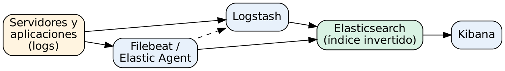

# Administración de Elasticsearch para gestión y análisis de logs

## Práctica 1. Cuestionario de comprobación de conocimientos

### Objetivo

Al finalizar la práctica, serás capaz de verificar tu comprensión de los fundamentos del Elastic Stack: motores de búsqueda e índice invertido, gestión centralizada de logs, componentes del stack, cambios relevantes de la serie 8.x y uso de la API REST con JSON, curl y Kibana Dev Tools.

### Objetivo visual

### Duración aproximada

- 20 minutos.

### Prerrequisitos

- Haber revisado los temas 1.1 a 1.4 del Capítulo 1.
- Papel y lápiz, o un editor de texto, para registrar tus respuestas.
- No se requiere tener instalado Elasticsearch (la instalación se hace en la Práctica 2).

---

### Instrucciones

Esta práctica es individual. Responde primero las 15 preguntas **sin consultar** el material. Después compara tus respuestas con la clave de la sección **Resultado esperado** y lee la justificación de cada una. Las preguntas que falles te indican qué subtema repasar antes de continuar con la Práctica 2.

---

### Tarea 1. Responder el cuestionario

En esta tarea contestas preguntas de opción múltiple y de relación. El objetivo no es memorizar, sino confirmar que entiendes **por qué** cada componente existe y qué problema resuelve en una plataforma de logs.

#### Paso 1. Responde las preguntas del tema 1.1: motores de búsqueda, índice invertido y gestión centralizada de logs

Elige **una** respuesta por pregunta.

**1.** ¿Qué es un índice invertido?

- a) Una copia de seguridad del índice ordenada de forma descendente.
- b) Una estructura que asocia cada término con la lista de documentos que lo contienen.
- c) Una tabla relacional con una fila por documento y una columna por palabra.
- d) Un índice que almacena los documentos en orden cronológico inverso.

**2.** ¿Cuál es la razón principal para centralizar los logs de muchos servidores en una sola plataforma?

- a) Reducir el tamaño de los archivos de log en cada servidor.
- b) Poder buscar, correlacionar y analizar eventos de distintas fuentes en un solo lugar y con una misma línea de tiempo.
- c) Evitar que las aplicaciones escriban logs en disco.
- d) Sustituir la rotación de logs del sistema operativo.

**3.** Un analista busca la palabra `timeout` en millones de líneas de log. ¿Por qué un motor como Elasticsearch responde en milisegundos, mientras que `findstr` o `grep` sobre los archivos tardaría minutos?

- a) Porque Elasticsearch comprime los archivos de texto.
- b) Porque Elasticsearch ya analizó el texto al indexarlo y consulta el índice invertido en lugar de leer cada línea.
- c) Porque Elasticsearch solo guarda las últimas 24 horas de logs.
- d) Porque Elasticsearch usa una base de datos relacional optimizada.

#### Paso 2. Responde las preguntas del tema 1.2: componentes del Elastic Stack

**4.** Relaciona cada componente con su función principal (escribe la letra junto al número):

| Componente | | Función |
|---|---|---|
| 4.1 Elasticsearch | | A. Agente unificado administrado centralmente con Fleet que recolecta logs, métricas y datos de seguridad |
| 4.2 Kibana | | B. Motor distribuido que almacena, indexa y busca los datos |
| 4.3 Logstash | | C. Recolector ligero especializado en leer archivos de log y enviarlos |
| 4.4 Filebeat | | D. Interfaz web para explorar, visualizar, crear dashboards, alertas y administrar el stack |
| 4.5 Elastic Agent | | E. Motor de procesamiento con pipelines input-filter-output para transformar y enrutar eventos |

**5.** ¿Qué componente administra de forma centralizada las políticas y la actualización de muchos Elastic Agents?

- a) Logstash.
- b) Fleet (a través de Fleet Server).
- c) Metricbeat.
- d) Kibana Dev Tools.

**6.** Una organización necesita enriquecer eventos con datos de una base de datos externa y enviarlos a dos destinos distintos (Elasticsearch y un sistema de archivo). ¿Qué componente es el más adecuado?

- a) Filebeat.
- b) Logstash.
- c) Kibana.
- d) Elastic Agent sin integraciones.

#### Paso 3. Responde las preguntas del tema 1.3: evolución de versiones y serie 8.x

**7.** ¿Qué cambio importante introdujo Elasticsearch 8.0 en la configuración inicial de un nodo nuevo?

- a) Eliminó la necesidad de Java.
- b) Activó la seguridad por defecto: autenticación, TLS en las capas HTTP y transporte, y generación automática de la contraseña del usuario `elastic`.
- c) Eliminó la API REST en favor de gRPC.
- d) Obligó a usar Elastic Cloud.

**8.** En Elasticsearch 8.x, ¿cuál es la forma recomendada de almacenar datos de logs que solo se agregan (append-only) y tienen marca de tiempo?

- a) Un único índice gigante sin rollover.
- b) Data streams, respaldados por índices ocultos y con rollover automático.
- c) Un índice por cada línea de log.
- d) Tipos de mapping múltiples dentro de un índice.

**9.** ¿Qué es ES|QL?

- a) Un conector JDBC para bases de datos relacionales.
- b) Un lenguaje de consulta con comandos encadenados por tuberías (`|`), disponible en la serie 8.x, que permite filtrar, transformar y agregar datos.
- c) Un plugin de pago para exportar a Excel.
- d) El nuevo nombre de Query DSL.

#### Paso 4. Responde las preguntas del tema 1.4: API REST, JSON, curl y Dev Tools

**10.** ¿Qué verbo HTTP y ruta usarías para **obtener** el documento con ID `42` del índice `logs-app`?

- a) `POST /logs-app/_search/42`
- b) `GET /logs-app/_doc/42`
- c) `PUT /logs-app/_doc/42`
- d) `DELETE /logs-app/42`

**11.** En Windows 11, en PowerShell 5.1, ¿por qué conviene escribir `curl.exe` en lugar de `curl`?

- a) Porque `curl` no existe en Windows.
- b) Porque en PowerShell 5.1 `curl` es un alias de `Invoke-WebRequest`, que usa otra sintaxis; `curl.exe` invoca el curl real incluido en Windows.
- c) Porque `curl.exe` es más rápido.
- d) No hay diferencia.

**12.** ¿Qué ventaja ofrece Kibana Dev Tools (Console) frente a curl para aprender la API?

- a) Ejecuta comandos del sistema operativo.
- b) Autocompleta rutas y parámetros, da formato al JSON, maneja la autenticación con la sesión de Kibana y permite guardar el historial de peticiones.
- c) No requiere que Elasticsearch esté en ejecución.
- d) Permite editar los archivos `elasticsearch.yml` remotamente.

**13.** ¿Qué formato espera la Bulk API (`_bulk`) en el cuerpo de la petición?

- a) Un arreglo JSON con todos los documentos.
- b) NDJSON: una línea de acción seguida, cuando aplica, por una línea con el documento; cada línea termina con salto de línea, incluida la última.
- c) CSV con encabezados.
- d) XML.

**14.** La respuesta de una petición regresa el código HTTP `401`. ¿Qué significa?

- a) El índice no existe.
- b) La petición no se autenticó (faltan credenciales o son incorrectas).
- c) El clúster está en estado rojo.
- d) La consulta tiene un error de sintaxis.

**15.** ¿Cuál de las siguientes peticiones devuelve el estado de salud del clúster?

- a) `GET /_cluster/health`
- b) `GET /_health/cluster`
- c) `POST /_cluster/status`
- d) `GET /_cat/health_report`

---

### Tarea 2. Autoevaluar y registrar temas de repaso

Una vez que contestes todo, revisa tus respuestas con la clave. La justificación explica la idea central que se espera que domines.

#### Paso 5. Compara tus respuestas con la clave

Consulta la tabla de la sección **Resultado esperado**. Asigna 1 punto por respuesta correcta. En la pregunta 4 asigna 1 punto solo si las cinco relaciones son correctas.

**Qué hace y por qué:** comparar contra una clave con justificación convierte el error en aprendizaje: no basta con saber que una respuesta es incorrecta, sino entender el concepto que la hace correcta.

#### Paso 6. Registra los temas que debes repasar

Anota en una lista los números de las preguntas que fallaste y el subtema asociado (1.1, 1.2, 1.3 o 1.4). Repasa esos subtemas antes de iniciar la Práctica 2.

**Qué hace y por qué:** las prácticas siguientes suponen que dominas estos conceptos. Por ejemplo, la Práctica 3 usa la API REST y la Bulk API, y la Práctica 5 usa data streams, Filebeat y Logstash.

---

### Resultado esperado

Al terminar deberás tener tu calificación y la lista de temas por repasar. Se considera aprobado con **12 o más** aciertos de 15.

| # | Respuesta | Justificación | Subtema |
|---|---|---|---|
| 1 | b | El índice invertido relaciona cada término (token) con la lista de documentos y posiciones donde aparece. Es la base de la búsqueda de texto completo. | 1.1 |
| 2 | b | Centralizar permite buscar y correlacionar eventos de muchas fuentes con una sola línea de tiempo, retener los logs aunque el servidor falle y controlar el acceso. | 1.1 |
| 3 | b | El texto se analiza (tokeniza) al indexar; en la búsqueda solo se consulta el diccionario de términos del índice invertido. | 1.1 |
| 4 | 4.1-B, 4.2-D, 4.3-E, 4.4-C, 4.5-A | Cada componente cumple un papel: almacenar y buscar (Elasticsearch), visualizar y administrar (Kibana), transformar (Logstash), recolectar archivos (Filebeat) y recolección unificada administrada (Elastic Agent). | 1.2 |
| 5 | b | Fleet, servido por Fleet Server, administra de forma central las políticas, integraciones y actualizaciones de los Elastic Agents. | 1.2 |
| 6 | b | Logstash es el componente indicado para enriquecimiento complejo y para enviar a múltiples salidas. | 1.2 |
| 7 | b | A partir de 8.0 la seguridad viene activada por defecto: TLS, autenticación y contraseña de `elastic` generada en el primer arranque. | 1.3 |
| 8 | b | Los data streams son el mecanismo nativo para series de tiempo append-only, con backing indices y rollover. | 1.3 |
| 9 | b | ES\|QL es un lenguaje con tuberías (`FROM ... \| WHERE ... \| STATS ...`), disponible de forma general en la serie 8.x. | 1.3 |
| 10 | b | `GET /<índice>/_doc/<id>` recupera un documento por su ID. | 1.4 |
| 11 | b | En Windows PowerShell 5.1, `curl` es alias de `Invoke-WebRequest`; para usar la sintaxis de curl se invoca `curl.exe`. | 1.4 |
| 12 | b | Dev Tools autocompleta, da formato, reutiliza la sesión autenticada de Kibana y conserva el historial. | 1.4 |
| 13 | b | La Bulk API recibe NDJSON (JSON delimitado por saltos de línea), y la última línea también debe terminar con salto de línea. | 1.4 |
| 14 | b | 401 Unauthorized indica que faltan credenciales o son inválidas; 403 indica que el usuario sí se autenticó, pero no tiene permisos. | 1.4 |
| 15 | a | `GET /_cluster/health` regresa el estado `green`, `yellow` o `red` y el conteo de shards. | 1.4 |

> **Importante:** si obtuviste menos de 12 aciertos, repasa los subtemas indicados antes de la Práctica 2. La instalación y las prácticas siguientes dan por entendidos estos conceptos.

### Referencias

- Elastic. *Elasticsearch Guide [8.19]: What is Elasticsearch?* https://www.elastic.co/guide/en/elasticsearch/reference/8.19/elasticsearch-intro.html
- Elastic. *Elastic Stack and product documentation.* https://www.elastic.co/guide/index.html
- Elastic. *ES|QL [8.19].* https://www.elastic.co/guide/en/elasticsearch/reference/8.19/esql.html
