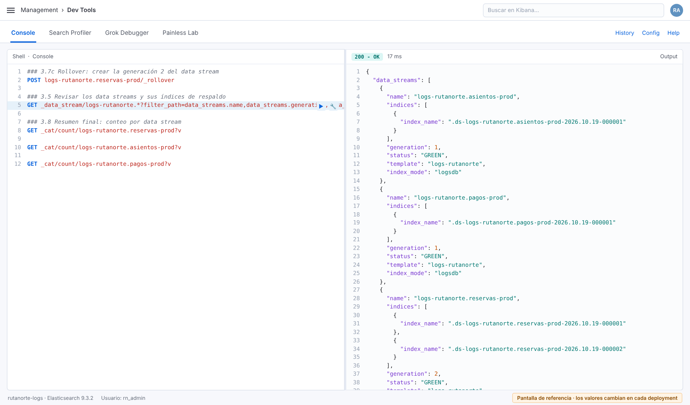

# Lab 3 · Templates, mappings y data streams para los logs de RutaNorte

| | |
|---|---|
| **Duración** | 1 hora 5 minutos |
| **Entorno** | Kibana › Dev Tools › Console (sesión de `rn_admin`) |
| **Archivos que usarás** | `cap03/lab03-templates.txt` (comandos) · `cap03/lab03-bulk-eventos.txt` (carga de eventos) · `cap03/eventos-rutanorte.ndjson` (datos de origen) |
| **Requisitos** | Labs 0 a 2 completos; clúster en `green` |
| **Deja listo para** | Lab 4 (ingest pipelines), Lab 5 (consultas) y Lab 7 (ILM) |

---

## Objetivo

Diseñar el almacenamiento de los logs de RutaNorte:
- crear **component templates** reutilizables para settings y mappings;
- combinarlos en un **index template** y simular el resultado antes de escribir datos;
- crear los **data streams** de tres servicios con eventos reales;
- provocar un **rechazo de mapping** para entender su causa y cómo evitarlo;
- evolucionar el diseño con un **rollover**.

## Contexto

Con la plataforma entregada y documentada (Labs 0 a 2), RutaNorte está lista para recibir logs. Si cada servicio escribiera "como sea", en pocas semanas habría:
- un `status_code` guardado como texto en un servicio y como número en otro;
- montos imposibles de sumar;
- miles de campos creados por accidente que inflan el estado del clúster.

El equipo de Plataforma define hoy **el contrato de datos**: cómo se llaman los data streams, qué tipo tiene cada campo y qué pasa con los campos inesperados. Lo harás con piezas reutilizables, porque en el Lab 4 se sumarán los tres servicios restantes con el mismo diseño.

**Decisiones de diseño de RutaNorte**

| Decisión | Elección | Justificación |
|---|---|---|
| Contenedor | Un **data stream** por servicio y ambiente: `logs-rutanorte.<servicio>-prod` | Los logs solo se agregan y tienen fecha; el data stream gestiona el rollover y el índice de escritura. Separar por servicio permite permisos y retención distintos (Lab 7) |
| Shards | 1 primario + 1 réplica | Volumen de laboratorio pequeño; la réplica protege contra la caída de una zona (Lab 1) |
| Campos conocidos | Mapping explícito con nombres **ECS** | Tipos correctos desde el primer evento y consultas uniformes entre servicios |
| Campos desconocidos | Se aceptan como `keyword`, con un límite de 500 campos | Flexibilidad sin riesgo de *mapping explosion* |
| Etiquetas libres | `labels` como `flattened` | Claves arbitrarias sin crear un campo por clave |

## Qué vas a hacer

| Paso | Actividad | Recurso que crea o modifica |
|---|---|---|
| 3.1 | Revisar la plantilla integrada `logs` | — |
| 3.2 | Crear los component templates de settings y mappings | `rutanorte@settings`, `rutanorte@mappings` |
| 3.3 | Crear el index template y simular el índice resultante | `logs-rutanorte` |
| 3.4 | Cargar 48 eventos con `_bulk` | 3 data streams |
| 3.5 | Revisar los data streams, los mappings y los campos `flattened` | — |
| 3.6 | Provocar un rechazo de mapping y corregirlo | — |
| 3.7 | Evolucionar el template y hacer rollover | `rutanorte@mappings` v2, generación 2 |
| 3.8 | Verificar los conteos finales | — |

---

## Paso 3.1 · Revisar la plantilla integrada `logs`

**Qué estás haciendo.** En el Lab 1 el data stream `logs-lab01…` se creó con la plantilla integrada `logs`. Antes de crear la tuya, revisas qué patrón cubre y con qué prioridad, para que la de RutaNorte **gane** sobre ella.

Ejecuta el bloque **3.1**:

```
GET _index_template/logs?filter_path=index_templates.name,index_templates.index_template.index_patterns,index_templates.index_template.priority,index_templates.index_template.composed_of
```

**Resultado esperado** (extracto):

```json
{
  "index_templates": [ {
    "name": "logs",
    "index_template": {
      "index_patterns": [ "logs-*-*" ],
      "priority": 100,
      "composed_of": [ "logs@mappings", "logs@settings", "logs@custom", "ecs@mappings" ]
    }
  } ]
}
```

**Interpretación.** Todo nombre `logs-*-*` usa esta plantilla de prioridad 100. Cuando dos index templates coinciden con un nombre, **se aplica solo uno: el de mayor `priority`**. Las plantillas no se mezclan. Por eso la de RutaNorte tendrá prioridad **200**.

## Paso 3.2 · Crear los component templates

**Qué estás haciendo.** Un *component template* es un bloque reutilizable de settings, mappings o aliases. Por sí solo no se aplica a ningún índice: se usa al componerlo en un index template. Separar settings y mappings permite cambiar uno sin tocar el otro y reutilizarlos en otros index templates (por ejemplo, para los logs de auditoría del Lab 7).

**3.2 · Settings.** Ejecuta el bloque **3.2**:

```
PUT _component_template/rutanorte@settings
{
  "template": {
    "settings": {
      "index.number_of_shards": 1,
      "index.number_of_replicas": 1,
      "index.refresh_interval": "5s",
      "index.codec": "best_compression",
      "index.mapping.total_fields.limit": 500,
      "index.mapping.ignore_malformed": false
    }
  },
  "version": 1,
  "_meta": { "descripcion": "...", "propietario": "equipo-plataforma", "creado_en": "lab-03" }
}
```

| Setting | Valor | Explicación |
|---|---|---|
| `index.number_of_shards` | `1` | Un primario por índice de respaldo. Un shard aguanta decenas de GB; el rollover crea índices nuevos cuando hace falta |
| `index.number_of_replicas` | `1` | Una copia en la otra zona |
| `index.refresh_interval` | `5s` | Cada cuánto se vuelven buscables los documentos nuevos. El valor por defecto es 1 s; 5 s reduce el trabajo de indexación a cambio de unos segundos de retraso, aceptable para logs |
| `index.codec` | `best_compression` | Comprime más los datos almacenados. Ahorra disco con un costo menor de CPU |
| `index.mapping.total_fields.limit` | `500` | Máximo de campos por índice. Es la barrera contra la *mapping explosion*. El valor por defecto es 1000 |
| `index.mapping.ignore_malformed` | `false` | Si un valor no coincide con su tipo, **se rechaza el documento**. Lo fijas explícitamente porque las plantillas de logs pueden activarlo, y en RutaNorte se prefiere detectar los errores a ocultarlos |
| `version` | `1` | Número de versión del template, para tu control de cambios. Elasticsearch no lo interpreta |
| `_meta` | objeto | Documentación libre: propietario, propósito y origen |

> **Convención de nombres.** El sufijo `@settings` / `@mappings` imita el estilo de las plantillas integradas (`logs@settings`) y deja claro qué contiene cada componente.

**3.2b · Mappings.** Ejecuta el bloque **3.2b** (completo en el archivo). Sus partes principales:

```
PUT _component_template/rutanorte@mappings
{
  "template": {
    "mappings": {
      "dynamic": true,
      "date_detection": false,
      "dynamic_templates": [
        { "cadenas_como_keyword": {
            "match_mapping_type": "string",
            "mapping": { "type": "keyword", "ignore_above": 1024 } } }
      ],
      "properties": {
        "@timestamp": { "type": "date" },
        "message":    { "type": "match_only_text" },
        "http": { "properties": { "response": { "properties": { "status_code": { "type": "short" } } } } },
        "client": { "properties": { "ip": { "type": "ip" } } },
        "labels": { "type": "flattened" },
        "rutanorte": { "properties": {
          "monto_mxn": { "type": "scaled_float", "scaling_factor": 100 } } }
        ...
      }
    }
  }
}
```

| Elemento | Explicación |
|---|---|
| `dynamic: true` | Los campos no declarados **se aceptan** y se mapean automáticamente. Alternativas: `false` (se guardan en `_source` pero no se indexan) y `strict` (se rechaza el documento) |
| `date_detection: false` | Evita que una cadena con apariencia de fecha, como `"2026-03-27"`, se convierta en campo `date` por accidente |
| `dynamic_templates` › `cadenas_como_keyword` | Regla para los campos nuevos: toda cadena desconocida se mapea como `keyword`. Sin esta regla se crearían **dos** campos por cadena (`text` + `.keyword`) |
| `ignore_above: 1024` | Las cadenas de más de 1024 caracteres se guardan, pero no se indexan |
| `@timestamp: date` | Campo de tiempo obligatorio del data stream |
| `message: match_only_text` | Texto de búsqueda completa optimizado para logs: ocupa menos espacio que `text` porque no guarda frecuencias ni posiciones |
| `log.level`, `service.name`, `trace.id`… `keyword` | Valores exactos para filtrar y agregar |
| `http.response.status_code: short` | Número entero pequeño (−32 768 a 32 767). Permite rangos como `>= 500` |
| `event.duration: long` | Duración en **nanosegundos**, según ECS |
| `client.ip: ip` | Admite búsquedas por rango o CIDR, como `189.203.0.0/16` |
| `labels: flattened` | Todo el objeto se indexa como **un solo campo**, aunque traiga claves nuevas. Protege contra la *mapping explosion* |
| `rutanorte.*` | Campos de negocio propios, fuera del espacio ECS |
| `monto_mxn: scaled_float` (factor 100) | Guarda el monto como entero de centavos: preciso para dinero y compacto |

**3.2c · Revisión.** Ejecuta el bloque **3.2c**. Debes ver ambos componentes con `version: 1` y su `_meta`.

## Paso 3.3 · Crear el index template y simular

**Qué estás haciendo.** El *index template* es la regla que se activa al crear un índice o data stream cuyo nombre coincide con el patrón. Combina los componentes **en orden** (si dos definen lo mismo, gana el último) y declara que el resultado es un data stream.

Ejecuta el bloque **3.3**:

```
PUT _index_template/logs-rutanorte
{
  "index_patterns": [ "logs-rutanorte.*-*" ],
  "data_stream": {},
  "priority": 200,
  "composed_of": [ "rutanorte@settings", "rutanorte@mappings" ],
  "version": 1,
  "_meta": { "descripcion": "Data streams de logs de los servicios de RutaNorte", ... }
}
```

| Parámetro | Explicación |
|---|---|
| `index_patterns` | Nombres a los que aplica. `logs-rutanorte.*-*` cubre `logs-rutanorte.reservas-prod`, `logs-rutanorte.pagos-qa`, etc. |
| `data_stream: {}` | Indica que los nombres que coincidan se crean como **data streams**, no como índices normales |
| `priority: 200` | Gana sobre la plantilla integrada `logs` (100). Dos templates que se traslapan **no pueden** tener la misma prioridad |
| `composed_of` | Component templates a combinar, en orden |

**3.3b · Simular antes de escribir.** Ejecuta el bloque **3.3b**:

```
POST _index_template/_simulate_index/logs-rutanorte.reservas-prod
```

La simulación muestra **la configuración exacta** que tendría un índice con ese nombre, **sin crearlo**. Revisa:

| Sección de la respuesta | Qué comprobar |
|---|---|
| `template.settings.index` | `number_of_shards: 1`, `refresh_interval: 5s`, `codec: best_compression`. También puede aparecer `mode: logsdb`, que Elasticsearch 9.x aplica automáticamente a los data streams `logs-*-*` |
| `template.mappings.properties` | Los campos de `rutanorte@mappings` con sus tipos |
| `overlapping` | `[{ "name": "logs", "index_patterns": ["logs-*-*"] }]`: confirma que la plantilla integrada también coincidía, pero **perdió** por prioridad |

> **Buena práctica.** Simula siempre después de cambiar un template. Un error de prioridad o de orden de componentes se descubre aquí, no en producción.

## Paso 3.4 · Cargar los eventos de prueba

**Qué estás haciendo.** Escribes 48 eventos reales de RutaNorte (16 por servicio) con la API `_bulk`. Cada evento va a un data stream distinto según su servicio. Como los data streams **no existen todavía**, Elasticsearch los crea al recibir el primer evento, usando tu template.

1. Abre `cap03/lab03-bulk-eventos.txt`.
2. Copia **todo** su contenido y pégalo en una pestaña limpia de Console.
3. Coloca el cursor en la línea `POST _bulk` y ejecuta.

Estructura del archivo:

```
POST _bulk
{"create": {"_index": "logs-rutanorte.reservas-prod"}}
{"@timestamp": "2026-03-27T18:00:27.899Z", "service.name": "reservas-api", "log.level": "info", ...}
{"create": {"_index": "logs-rutanorte.asientos-prod"}}
{"@timestamp": "...", "service.name": "asientos-api", ...}
...
```

| Parte | Explicación |
|---|---|
| `POST _bulk` (sin índice en la ruta) | Cada acción indica su propio destino en `_index`, así que una sola solicitud alimenta tres data streams |
| `create` | Única acción de escritura válida en data streams |
| Campos con punto (`service.name`) y objetos (`rutanorte: {…}`) | Ambas formas son equivalentes; Elasticsearch las convierte en la misma estructura de objetos |

**Resultado esperado:** `"errors": false` y 48 elementos en `items`, cada uno con `"status": 201`.

> El archivo `eventos-rutanorte.ndjson` tiene los mismos 48 eventos en formato NDJSON puro (un evento por línea, sin líneas de acción). Lo usarás como datos de origen en labs posteriores y para la carga desde **Integrations › Upload a file**.

## Paso 3.5 · Revisar los data streams y su mapping efectivo

**Qué estás haciendo.** Compruebas que los data streams se crearon con **tu** template y que los campos tienen los tipos que diseñaste.

**3.5 · Data streams e índices de respaldo.** Ejecuta el bloque **3.5**:

```
GET _data_stream/logs-rutanorte.*?filter_path=data_streams.name,data_streams.generation,data_streams.template,data_streams.index_mode,data_streams.status,data_streams.indices.index_name

GET _cat/indices/.ds-logs-rutanorte.*?v&h=index,health,pri,rep,docs.count,store.size&s=index
```

| Campo | Valor esperado |
|---|---|
| `name` | `logs-rutanorte.asientos-prod`, `logs-rutanorte.pagos-prod`, `logs-rutanorte.reservas-prod` |
| `template` | **`logs-rutanorte`**, no `logs` |
| `generation` | `1` |
| `index_mode` | `logsdb` (predeterminado en 9.x para `logs-*-*`) |
| `docs.count` en `_cat/indices` | 16 por índice de respaldo |

> Observa que `ilm_policy` **no aparece**: tu template todavía no define ciclo de vida. En el Lab 7 le asignarás una política de retención.

**3.5b · Mapping efectivo.** Ejecuta el bloque **3.5b**:

```
GET logs-rutanorte.pagos-prod/_mapping/field/http.response.status_code,rutanorte.monto_mxn,client.ip,message
```

`_mapping/field/<campos>` devuelve solo la definición de esos campos en cada índice de respaldo. Confirma `short`, `scaled_float`, `ip` y `match_only_text`.

**3.5c · Dynamic template en acción.** Los eventos de `reservas-api` traen el campo `user_agent.original`, que **no** está declarado en `rutanorte@mappings`. Ejecuta el bloque **3.5c**:

```
GET logs-rutanorte.reservas-prod/_mapping/field/user_agent.original
```

Elasticsearch lo creó al recibir el primer evento, aplicando tu regla `cadenas_como_keyword`: el tipo es `keyword` con `ignore_above: 1024`, sin el subcampo `.keyword` que habría creado el mapeo dinámico por defecto.

**3.5d · Primera consulta.** Ejecuta el bloque **3.5d**:

```
GET logs-rutanorte.pagos-prod/_search
{
  "size": 3,
  "sort": [ { "@timestamp": "desc" } ],
  "_source": [ "@timestamp", "log.level", "message", "rutanorte.monto_mxn", "http.response.status_code" ],
  "query": { "term": { "event.outcome": "failure" } }
}
```

| Parámetro | Explicación |
|---|---|
| `size` | Número de documentos a devolver |
| `sort` | Orden: los eventos más recientes primero |
| `_source` | Campos a incluir en cada resultado |
| `term` | Coincidencia exacta sobre un campo `keyword`. Encuentra los 3 pagos fallidos (HTTP 502) |

Las consultas a fondo son tema del Lab 5. Aquí solo compruebas que los datos son consultables por tipo.

**3.5e · `flattened` contra la mapping explosion.** Ejecuta las tres solicitudes del bloque **3.5e**:
1. Indexa un evento con **tres claves nuevas** en `labels` (`canal`, `campania`, `experimento`).
2. Consulta el mapping de `labels*`: sigue existiendo **un solo campo**, `labels`, de tipo `flattened`.
3. Busca con `term` sobre `labels.campania`: funciona sin que exista un campo `labels.campania` en el mapping.

> Si `labels` fuera un objeto dinámico, cada clave nueva (una por campaña, por experimento, por cliente…) crearía un campo. Con suficiente variedad se alcanza el límite de 500 campos y los documentos empiezan a rechazarse. Eso es la *mapping explosion*.

## Paso 3.6 · Provocar y explicar un rechazo de mapping

**Qué estás haciendo.** Reproduces un error real de integración: el equipo de Pagos envía el monto con formato de moneda (`"1,250.00"`) en lugar de como número.

Ejecuta el bloque **3.6**. **Resultado esperado: HTTP 400**

```json
{
  "error": {
    "root_cause": [ {
      "type": "document_parsing_exception",
      "reason": "[1:217] failed to parse field [rutanorte.monto_mxn] of type [scaled_float] in document with id '...'. Preview of field's value: '1,250.00'"
    } ],
    "type": "document_parsing_exception",
    "reason": "[1:217] failed to parse field [rutanorte.monto_mxn] of type [scaled_float] ...",
    "caused_by": {
      "type": "number_format_exception",
      "reason": "For input string: \"1,250.00\""
    }
  },
  "status": 400
}
```

**Interpretación**

| Pregunta | Respuesta |
|---|---|
| ¿Qué campo falló? | `rutanorte.monto_mxn`, de tipo `scaled_float` |
| ¿Por qué? | La coma de miles no es un número válido. Elasticsearch acepta `1250.00` o `"1250.00"`, pero no `"1,250.00"` |
| ¿Qué le pasó al documento? | **Se rechazó completo**: no se indexó ningún campo del evento |
| ¿Por qué no se ignoró el campo? | Porque fijaste `index.mapping.ignore_malformed: false` en `rutanorte@settings` |

Ejecuta el bloque **3.6b**: el mismo evento con `"monto_mxn": 1250.00` se indexa con `"result": "created"`.

**¿Cómo se evita en producción?**

| Opción | Cuándo usarla | Costo |
|---|---|---|
| Corregir el origen (el servicio envía un número) | Siempre que sea posible | Coordinar con el equipo dueño del servicio |
| Normalizar en un **ingest pipeline** (procesadores `gsub` y `convert`) | Cuando no controlas el origen | Mantener el pipeline (**Lab 4**) |
| **Failure store** del data stream | Para no perder nunca un evento rechazado y revisarlo después | Monitorear y reprocesar los fallos (**Lab 4**) |
| `ignore_malformed: true` | Cuando el campo es secundario | El evento entra, pero sin ese campo, y nadie se entera |

> **Si en lugar del error 400 recibes `201` con `"failure_store": "used"`**, tu deployment tiene el *failure store* activado para `logs-*-*`: el evento no se perdió, se guardó aparte. Revísalo con `GET logs-rutanorte.pagos-prod::failures/_search`. Lo estudiarás en el Lab 4.

## Paso 3.7 · Evolucionar el diseño con un rollover

**Qué estás haciendo.** Reservas pide registrar el número de pasajeros por reserva. Aprenderás la regla más importante de los templates: **solo se aplican al crear un índice**. Cambiar un template no modifica los índices de respaldo existentes. El cambio llega con la siguiente generación del data stream.

1. Ejecuta el bloque **3.7**, que redefine `rutanorte@mappings` con `"version": 2` y el campo nuevo `rutanorte.pasajeros` de tipo `byte` (entero de −128 a 127).
2. Ejecuta el bloque **3.7b**. El índice de respaldo actual **no** tiene el campo: la respuesta muestra `"mappings": {}` para él.
3. Ejecuta el bloque **3.7c**:

```
POST logs-rutanorte.reservas-prod/_rollover
```

| Campo de la respuesta | Significado |
|---|---|
| `old_index` | `.ds-logs-rutanorte.reservas-prod-AAAA.MM.DD-000001`: deja de recibir escrituras, pero se sigue consultando |
| `new_index` | `.ds-logs-rutanorte.reservas-prod-AAAA.MM.DD-000002`: nuevo índice de escritura, creado con el template **vigente** |
| `rolled_over` | `true` |

4. Ejecuta el bloque **3.7d**. El data stream tiene `generation: 2` y dos índices de respaldo, y `rutanorte.pasajeros` aparece **solo** en el nuevo.

> Las búsquedas sobre `logs-rutanorte.reservas-prod` consultan **ambos** índices de respaldo de forma transparente. En el Lab 7, ILM hará el rollover automáticamente por tamaño o antigüedad.

## Paso 3.8 · Conteos finales

Ejecuta el bloque **3.8**:

```
GET _cat/count/logs-rutanorte.reservas-prod?v
GET _cat/count/logs-rutanorte.asientos-prod?v
GET _cat/count/logs-rutanorte.pagos-prod?v
```

| Data stream | Documentos esperados | Origen |
|---|---|---|
| `logs-rutanorte.reservas-prod` | **17** | 16 del bulk + 1 de la prueba de `labels` (3.5e) |
| `logs-rutanorte.asientos-prod` | **16** | 16 del bulk |
| `logs-rutanorte.pagos-prod` | **17** | 16 del bulk + 1 corregido (3.6b); el rechazado no cuenta |

> **No borres estos data streams ni los templates.** Son la base de los labs siguientes.

---

## Verificación

- [ ] `rutanorte@settings` y `rutanorte@mappings` existen, documentados con `_meta`. Los mappings están en `version: 2`.
- [ ] `logs-rutanorte` tiene prioridad 200 y la simulación lista a `logs` en `overlapping`.
- [ ] Los tres data streams usan el template `logs-rutanorte`.
- [ ] Los mappings efectivos muestran `short`, `scaled_float`, `ip`, `match_only_text` y `flattened`.
- [ ] Explicaste el rechazo de `monto_mxn`: campo, causa, efecto y cómo evitarlo.
- [ ] `logs-rutanorte.reservas-prod` está en la generación 2 y solo el índice nuevo tiene `rutanorte.pasajeros`.
- [ ] Los conteos son 17, 16 y 17.

## Pantalla de resultado final



*Pantalla de referencia del Paso 3.7d / 3.5: los tres data streams `logs-rutanorte.*` creados con el template `logs-rutanorte`, en modo `logsdb`, y `reservas-prod` en la generación 2. Las fechas de los índices de respaldo corresponden al día en que hagas el lab.*

Para verlo también de forma gráfica, abre **Stack Management › Index Management › Data Streams** y filtra por `rutanorte`.

## Solución de problemas

| Síntoma | Causa probable | Solución |
|---|---|---|
| `index template [logs-rutanorte] has index patterns [...] matching patterns from existing templates [logs] with patterns (...) that have the same priority [100]` | La prioridad quedó en 100 | Usa `"priority": 200` |
| El data stream muestra `"template": "logs"` | Escribiste eventos **antes** de crear tu template | Borra el data stream (`DELETE _data_stream/<nombre>`), revisa el template con el bloque 3.3b y repite el Paso 3.4 |
| `_bulk` responde `"errors": true` | Algún evento no coincide con el mapping | Busca en `items` los elementos con `status` distinto de 201 y lee su `error.reason` |
| `illegal_argument_exception` … `only write ops with an op_type of create are allowed in data streams` | Usaste `index` o `PUT …/_doc/<id>` | En data streams usa `create` o `POST …/_doc` |
| El documento de 3.6 se indexó sin error | El template no tiene `ignore_malformed: false` o el failure store está activo | Revisa el bloque 3.2 y la nota sobre failure store del Paso 3.6 |

## Preguntas de reflexión

1. ¿Por qué RutaNorte usa un data stream por servicio en vez de uno para todos? Piensa en permisos (Pagos no debe ver Reservas) y en retención.
2. Si mañana `pagos-api` empieza a enviar `http.response.status_code` como `"200 OK"`, ¿qué pasará? ¿Qué opción de la tabla del Paso 3.6 elegirías?
3. ¿Qué diferencia hay entre cambiar `number_of_replicas` en un template y cambiarlo con `PUT <índice>/_settings`?

## Lo que dejas listo para el Lab 4

- Templates **`rutanorte@settings`**, **`rutanorte@mappings` (v2)** y **`logs-rutanorte`**.
- Data streams **`logs-rutanorte.reservas-prod`**, **`asientos-prod`** y **`pagos-prod`** con 50 eventos en total.

En el Lab 4 llegarán los servicios que **no** envían JSON limpio: `api-gateway` escribe líneas de texto y `portal-web` usa nombres de campo propios. Construirás **ingest pipelines** que los conviertan al contrato de datos que diseñaste hoy.

---

## Archivo completo · `cap03/lab03-templates.txt`

```
# =====================================================================
# Lab 3 · Templates, mappings y data streams para los logs de RutaNorte
# Archivo: cap03/lab03-templates.txt
# Entorno: Kibana › Dev Tools › Console (sesión de rn_admin)
# Los eventos de prueba están en cap03/lab03-bulk-eventos.txt (Paso 3.4)
# =====================================================================

### 3.1 Antes de crear: ¿qué plantillas ya existen para logs-*-*?
GET _index_template/logs?filter_path=index_templates.name,index_templates.index_template.index_patterns,index_templates.index_template.priority,index_templates.index_template.composed_of

### 3.2 Component template de settings
PUT _component_template/rutanorte@settings
{
  "template": {
    "settings": {
      "index.number_of_shards": 1,
      "index.number_of_replicas": 1,
      "index.refresh_interval": "5s",
      "index.codec": "best_compression",
      "index.mapping.total_fields.limit": 500,
      "index.mapping.ignore_malformed": false
    }
  },
  "version": 1,
  "_meta": {
    "descripcion": "Settings comunes de los data streams de logs de RutaNorte",
    "propietario": "equipo-plataforma",
    "creado_en": "lab-03"
  }
}

### 3.2b Component template de mappings
PUT _component_template/rutanorte@mappings
{
  "template": {
    "mappings": {
      "dynamic": true,
      "date_detection": false,
      "dynamic_templates": [
        {
          "cadenas_como_keyword": {
            "match_mapping_type": "string",
            "mapping": { "type": "keyword", "ignore_above": 1024 }
          }
        }
      ],
      "properties": {
        "@timestamp": { "type": "date" },
        "message":    { "type": "match_only_text" },
        "log":     { "properties": { "level": { "type": "keyword" } } },
        "service": { "properties": {
          "name":        { "type": "keyword" },
          "environment": { "type": "keyword" },
          "version":     { "type": "keyword" }
        } },
        "host":    { "properties": { "name": { "type": "keyword" } } },
        "event":   { "properties": {
          "outcome":  { "type": "keyword" },
          "duration": { "type": "long" }
        } },
        "http":    { "properties": {
          "request":  { "properties": { "method": { "type": "keyword" } } },
          "response": { "properties": { "status_code": { "type": "short" } } }
        } },
        "url":     { "properties": { "path": { "type": "keyword" } } },
        "client":  { "properties": { "ip": { "type": "ip" } } },
        "trace":   { "properties": { "id": { "type": "keyword" } } },
        "error":   { "properties": {
          "type":    { "type": "keyword" },
          "message": { "type": "match_only_text" }
        } },
        "labels":  { "type": "flattened" },
        "rutanorte": { "properties": {
          "reserva_id":  { "type": "keyword" },
          "corrida":     { "type": "keyword" },
          "origen":      { "type": "keyword" },
          "destino":     { "type": "keyword" },
          "metodo_pago": { "type": "keyword" },
          "monto_mxn":   { "type": "scaled_float", "scaling_factor": 100 }
        } }
      }
    }
  },
  "version": 1,
  "_meta": {
    "descripcion": "Mappings ECS y de negocio para los logs de RutaNorte",
    "propietario": "equipo-plataforma",
    "creado_en": "lab-03"
  }
}

### 3.2c Revisar los component templates creados
GET _component_template/rutanorte@*?filter_path=component_templates.name,component_templates.component_template.version,component_templates.component_template._meta

### 3.3 Index template que combina ambos componentes
PUT _index_template/logs-rutanorte
{
  "index_patterns": [ "logs-rutanorte.*-*" ],
  "data_stream": {},
  "priority": 200,
  "composed_of": [ "rutanorte@settings", "rutanorte@mappings" ],
  "version": 1,
  "_meta": {
    "descripcion": "Data streams de logs de los servicios de RutaNorte",
    "propietario": "equipo-plataforma",
    "creado_en": "lab-03"
  }
}

### 3.3b Simular el índice que se crearía para reservas-api
POST _index_template/_simulate_index/logs-rutanorte.reservas-prod

### 3.4 Cargar los eventos: ejecuta el archivo cap03/lab03-bulk-eventos.txt
# (48 eventos de reservas-api, asientos-api y pagos-api)

### 3.5 Revisar los data streams y sus índices de respaldo
GET _data_stream/logs-rutanorte.*?filter_path=data_streams.name,data_streams.generation,data_streams.template,data_streams.index_mode,data_streams.status,data_streams.indices.index_name

GET _cat/indices/.ds-logs-rutanorte.*?v&h=index,health,pri,rep,docs.count,store.size&s=index

### 3.5b Mapping efectivo de campos clave
GET logs-rutanorte.pagos-prod/_mapping/field/http.response.status_code,rutanorte.monto_mxn,client.ip,message

### 3.5c Un campo no declarado en el template (dynamic template en acción)
GET logs-rutanorte.reservas-prod/_mapping/field/user_agent.original

### 3.5d Consultar los eventos indexados
GET logs-rutanorte.pagos-prod/_search
{
  "size": 3,
  "sort": [ { "@timestamp": "desc" } ],
  "_source": [ "@timestamp", "log.level", "message", "rutanorte.monto_mxn", "http.response.status_code" ],
  "query": {
    "term": { "event.outcome": "failure" }
  }
}

### 3.5e labels es flattened: claves nuevas sin crear campos nuevos
POST logs-rutanorte.reservas-prod/_doc
{
  "@timestamp": "2026-03-27T18:20:00.000Z",
  "service.name": "reservas-api",
  "log.level": "info",
  "message": "Reserva RN-100399 creada desde campaña de temporada",
  "labels": { "canal": "app-ios", "campania": "verano-2026", "experimento": "checkout-b" }
}

GET logs-rutanorte.reservas-prod/_mapping/field/labels*

GET logs-rutanorte.reservas-prod/_search
{
  "size": 1,
  "_source": [ "message", "labels" ],
  "query": { "term": { "labels.campania": "verano-2026" } }
}

### 3.6 Provocar un rechazo de mapping: el monto llega como texto con coma
POST logs-rutanorte.pagos-prod/_doc
{
  "@timestamp": "2026-03-27T18:21:00.000Z",
  "service.name": "pagos-api",
  "log.level": "info",
  "message": "Pago aprobado para la reserva RN-100400",
  "http.response.status_code": 200,
  "rutanorte": { "reserva_id": "RN-100400", "monto_mxn": "1,250.00", "metodo_pago": "tarjeta" }
}

### 3.6b El mismo evento corregido en el origen: el monto como número
POST logs-rutanorte.pagos-prod/_doc
{
  "@timestamp": "2026-03-27T18:21:00.000Z",
  "service.name": "pagos-api",
  "log.level": "info",
  "message": "Pago aprobado para la reserva RN-100400",
  "http.response.status_code": 200,
  "rutanorte": { "reserva_id": "RN-100400", "monto_mxn": 1250.00, "metodo_pago": "tarjeta" }
}

### 3.7 Evolucionar el diseño: versión 2 del template de mappings
PUT _component_template/rutanorte@mappings
{
  "template": {
    "mappings": {
      "dynamic": true,
      "date_detection": false,
      "dynamic_templates": [
        {
          "cadenas_como_keyword": {
            "match_mapping_type": "string",
            "mapping": { "type": "keyword", "ignore_above": 1024 }
          }
        }
      ],
      "properties": {
        "@timestamp": { "type": "date" },
        "message":    { "type": "match_only_text" },
        "log":     { "properties": { "level": { "type": "keyword" } } },
        "service": { "properties": {
          "name":        { "type": "keyword" },
          "environment": { "type": "keyword" },
          "version":     { "type": "keyword" }
        } },
        "host":    { "properties": { "name": { "type": "keyword" } } },
        "event":   { "properties": {
          "outcome":  { "type": "keyword" },
          "duration": { "type": "long" }
        } },
        "http":    { "properties": {
          "request":  { "properties": { "method": { "type": "keyword" } } },
          "response": { "properties": { "status_code": { "type": "short" } } }
        } },
        "url":     { "properties": { "path": { "type": "keyword" } } },
        "client":  { "properties": { "ip": { "type": "ip" } } },
        "trace":   { "properties": { "id": { "type": "keyword" } } },
        "error":   { "properties": {
          "type":    { "type": "keyword" },
          "message": { "type": "match_only_text" }
        } },
        "labels":  { "type": "flattened" },
        "rutanorte": { "properties": {
          "reserva_id":  { "type": "keyword" },
          "corrida":     { "type": "keyword" },
          "origen":      { "type": "keyword" },
          "destino":     { "type": "keyword" },
          "metodo_pago": { "type": "keyword" },
          "monto_mxn":   { "type": "scaled_float", "scaling_factor": 100 },
          "pasajeros":   { "type": "byte" }
        } }
      }
    }
  },
  "version": 2,
  "_meta": {
    "descripcion": "Mappings ECS y de negocio para los logs de RutaNorte",
    "propietario": "equipo-plataforma",
    "creado_en": "lab-03",
    "cambio_v2": "Se agrega rutanorte.pasajeros (byte)"
  }
}

### 3.7b El índice de respaldo actual NO cambia: el template solo aplica al crear índices
GET logs-rutanorte.reservas-prod/_mapping/field/rutanorte.pasajeros

### 3.7c Rollover: crear la generación 2 del data stream
POST logs-rutanorte.reservas-prod/_rollover

### 3.7d La nueva generación ya incluye el campo
GET _data_stream/logs-rutanorte.reservas-prod?filter_path=data_streams.generation,data_streams.indices.index_name

GET logs-rutanorte.reservas-prod/_mapping/field/rutanorte.pasajeros

### 3.8 Resumen final: conteo por data stream
GET _cat/count/logs-rutanorte.reservas-prod?v

GET _cat/count/logs-rutanorte.asientos-prod?v

GET _cat/count/logs-rutanorte.pagos-prod?v
```

## Archivo de datos · `cap03/lab03-bulk-eventos.txt` (primeras líneas)

El archivo completo tiene 96 líneas de datos (48 acciones + 48 eventos) y se entrega en la carpeta `cap03/`.

```
# =====================================================================
# Lab 3 · Carga de eventos de prueba con la API _bulk
# Archivo: cap03/lab03-bulk-eventos.txt
# Entorno: Kibana › Dev Tools › Console
# Origen de los datos: cap03/eventos-rutanorte.ndjson (48 eventos)
# Ejecuta TODO el bloque como una sola solicitud (cursor en la línea POST _bulk).
# =====================================================================

### 3.4 Indexar 48 eventos en tres data streams
POST _bulk
{"create": {"_index": "logs-rutanorte.reservas-prod"}}
{"@timestamp": "2026-03-27T18:00:27.899Z", "service.name": "reservas-api", "service.environment": "prod", "service.version": "3.4.1", "host.name": "reservas-7f9c-2", "trace.id": "fe641ee5de3ab2469d706d0099fde583", "client.ip": "189.203.14.12", "rutanorte": {"reserva_id": "RN-100300", "corrida": "TIJ-HMO 07:15", "origen": "TIJ", "destino": "HMO"}, "http.request.method": "POST", "url.path": "/v1/reservas", "log.level": "info", "http.response.status_code": 201, "event.outcome": "success", "event.duration": 56000000, "message": "Reserva RN-100300 creada para la corrida TIJ-HMO 07:15", "labels": {"canal": "app-android"}, "user_agent.original": "RutaNorteApp/4.2.0 (Android 15)"}
{"create": {"_index": "logs-rutanorte.asientos-prod"}}
{"@timestamp": "2026-03-27T18:01:05.700Z", "service.name": "asientos-api", "service.environment": "prod", "service.version": "2.9.0", "host.name": "asientos-5d2b-1", "trace.id": "07fbe7aae24bdb59be1321176df6d4fc", "client.ip": "201.141.88.11", "rutanorte": {"reserva_id": "RN-100301", "corrida": "CUU-TRC 10:20", "origen": "CUU", "destino": "TRC"}, "http.request.method": "PUT", "url.path": "/v1/corridas/CUUTRC/asientos/25", "log.level": "info", "http.response.status_code": 200, "event.outcome": "success", "event.duration": 8000000, "message": "Asiento 25 bloqueado para la reserva RN-100301"}
{"create": {"_index": "logs-rutanorte.pagos-prod"}}
{"@timestamp": "2026-03-27T18:01:13.418Z", "service.name": "pagos-api", "service.environment": "prod", "service.version": "5.1.2", "host.name": "pagos-8a1e-1", "trace.id": "6c39682d3b041bbfdba2f0fd756edf4e", "client.ip": "189.203.14.24", "rutanorte": {"reserva_id": "RN-100302", "corrida": "SLT-MTY 19:10", "origen": "SLT", "destino": "MTY", "monto_mxn": 978, "metodo_pago": "tarjeta"}, "http.request.method": "POST", "url.path": "/v1/pagos", "log.level": "info", "http.response.status_code": 200, "event.outcome": "success", "event.duration": 1356000000, "message": "Pago aprobado de 978.00 MXN para la reserva RN-100302"}
...
```
