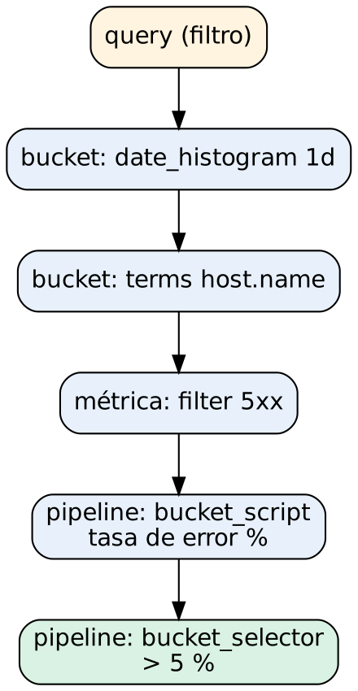

# Administración de Elasticsearch para gestión y análisis de logs

## Práctica 6. Construir agregaciones de eventos por servicio, severidad, código de respuesta e intervalo de tiempo

### Objetivo

Al finalizar la práctica, serás capaz de:

- Calcular métricas de logs con `avg`, `sum`, `min`, `max`, `stats`, `cardinality` y `percentiles`.
- Agrupar eventos con agregaciones de buckets: `terms`, `date_histogram`, `range`, `filters` y `significant_terms`.
- Anidar subagregaciones y aplicar agregaciones de pipeline: `derivative`, `moving_fn`, `bucket_script` y `bucket_selector`.
- Reconocer los aspectos de rendimiento y precisión: `size`/`shard_size`, resultados aproximados y paginación con `composite`.

### Objetivo visual



### Duración aproximada

- 65 minutos.

### Prerrequisitos

- Práctica 4 completada (conocimiento de mappings).
- Archivo `C:\labs\datos\cap06_logs_servicios.ndjson`: 3,489 eventos de los microservicios de la tienda, del **13 al 19 de octubre de 2026**, con latencia en `event.duration_ms`.

---

### Instrucciones

**Escenario:** el gerente de operaciones pide un informe semanal: volumen por servicio, latencias, tasas de error y la explicación de un incidente reportado el fin de semana. Responderás con agregaciones, sin exportar datos a una hoja de cálculo.

Todas las consultas usan `"size": 0`: no se necesitan los documentos, solo los resultados de las agregaciones. Así la respuesta es más pequeña y Elasticsearch puede usar la caché de peticiones.

---

### Tarea 1. Preparar el índice

#### Paso 1. Crea el índice con un mapping apto para agregaciones

```http
PUT servicios-logs-lab
{
  "settings": { "number_of_shards": 1, "number_of_replicas": 0 },
  "mappings": {
    "properties": {
      "@timestamp":                 { "type": "date" },
      "service.name":               { "type": "keyword" },
      "host.name":                  { "type": "keyword" },
      "log.level":                  { "type": "keyword" },
      "http.request.method":        { "type": "keyword" },
      "url.path":                   { "type": "keyword" },
      "http.response.status_code":  { "type": "long" },
      "event.duration_ms":          { "type": "long" },
      "http.response.body.bytes":   { "type": "long" },
      "source.ip":                  { "type": "ip" },
      "source.geo.country_iso_code":{ "type": "keyword" },
      "user.name":                  { "type": "keyword" }
    }
  }
}
```

**Qué hace y por qué:** las agregaciones leen los **doc_values**, una estructura columnar en disco que los campos `keyword`, numéricos, `date` e `ip` tienen activada por defecto. Los campos `text` **no** tienen doc_values y no se pueden agregar, salvo activando `fielddata`, que consume mucha memoria y no se recomienda. Por eso los campos de agrupación se definen como `keyword`. Puedes escribir los nombres con punto (`service.name`): Elasticsearch los convierte en objetos.

#### Paso 2. Carga los datos

En PowerShell:

```powershell
. C:\labs\scripts\entorno.ps1
es POST "/servicios-logs-lab/_bulk?refresh=true&filter_path=errors,took" -File C:\labs\datos\cap06_logs_servicios.ndjson
```

En Dev Tools:

```http
GET servicios-logs-lab/_count
```

**Qué hace y por qué:** carga los 3,489 eventos con la Bulk API. La respuesta debe tener `"errors": false` y el conteo debe ser **3489**.

---

### Tarea 2. Agregaciones de métricas

#### Paso 3. Calcula las métricas básicas de latencia y tráfico

```http
GET servicios-logs-lab/_search
{
  "size": 0,
  "aggs": {
    "latencia_promedio": { "avg": { "field": "event.duration_ms" } },
    "latencia_min":      { "min": { "field": "event.duration_ms" } },
    "latencia_max":      { "max": { "field": "event.duration_ms" } },
    "bytes_enviados":    { "sum": { "field": "http.response.body.bytes" } },
    "latencia_stats":    { "stats": { "field": "event.duration_ms" } }
  }
}
```

**Qué hace y por qué:** las agregaciones de **métricas** calculan un valor sobre el conjunto de documentos que cumplen la consulta. `stats` devuelve `count`, `min`, `max`, `avg` y `sum` en una sola pasada. Resultado: promedio ≈ **397.2 ms**, mínimo 12 ms, máximo 5,200 ms. El promedio está inflado por unos pocos eventos muy lentos, como verás en el paso siguiente.

#### Paso 4. Usa percentiles en lugar del promedio

```http
GET servicios-logs-lab/_search
{
  "size": 0,
  "aggs": {
    "latencia_percentiles": {
      "percentiles": { "field": "event.duration_ms", "percents": [50, 90, 95, 99] }
    }
  }
}
```

**Qué hace y por qué:** el **p50** (mediana) es ≈ **94 ms**, mientras que el promedio es 397 ms: la mayoría de las peticiones son rápidas y un grupo pequeño es muy lento. El **p95** (≈ 4,800 ms) indica que el 5 % de las peticiones tardó casi 5 segundos. Para medir la experiencia de usuario se usan percentiles, no promedios: un promedio "aceptable" puede ocultar a miles de usuarios con mal servicio. Los percentiles se calculan con el algoritmo TDigest, son **aproximados** y su precisión se ajusta con `tdigest.compression`.

#### Paso 5. Cuenta valores únicos con `cardinality`

```http
GET servicios-logs-lab/_search
{
  "size": 0,
  "aggs": {
    "usuarios_unicos": { "cardinality": { "field": "user.name" } },
    "ips_unicas":      { "cardinality": { "field": "source.ip", "precision_threshold": 3000 } }
  }
}
```

**Qué hace y por qué:** `cardinality` cuenta valores distintos (un `COUNT(DISTINCT)`) con el algoritmo HyperLogLog++, que usa poca memoria a cambio de ser aproximado. Hasta `precision_threshold` (máximo 40,000) el resultado es prácticamente exacto. Resultado: **159** usuarios únicos.

---

### Tarea 3. Agregaciones de buckets

Una agregación de **buckets** reparte los documentos en grupos. Cada bucket tiene un `doc_count` y puede contener subagregaciones.

#### Paso 6. Agrupa por servicio con `terms`

```http
GET servicios-logs-lab/_search
{
  "size": 0,
  "aggs": {
    "por_servicio": {
      "terms": { "field": "service.name", "size": 10 },
      "aggs": {
        "latencia_p95": { "percentiles": { "field": "event.duration_ms", "percents": [95] } }
      }
    }
  }
}
```

**Qué hace y por qué:** `terms` crea un bucket por valor, ordenado por `doc_count` descendente. Resultado: catalog (1,318), cart (563), auth (518), payment (457), checkout (362) e inventory (271). La subagregación calcula el p95 **por servicio** y muestra que `payment-service` tiene la latencia más alta, con mucha diferencia.

#### Paso 7. Ordena los buckets por una métrica

```http
GET servicios-logs-lab/_search
{
  "size": 0,
  "aggs": {
    "servicios_mas_lentos": {
      "terms": { "field": "service.name", "size": 3, "order": { "latencia_media": "desc" } },
      "aggs": { "latencia_media": { "avg": { "field": "event.duration_ms" } } }
    }
  }
}
```

**Qué hace y por qué:** `order` acepta el nombre de una subagregación de métrica, lo que equivale a un "top N servicios más lentos". Resultado: payment (≈ 2,258 ms), checkout (≈ 331 ms) y auth (≈ 129 ms).

#### Paso 8. Construye una serie de tiempo con `date_histogram`

```http
GET servicios-logs-lab/_search
{
  "size": 0,
  "aggs": {
    "por_dia": {
      "date_histogram": {
        "field": "@timestamp",
        "calendar_interval": "1d",
        "time_zone": "America/Mexico_City",
        "format": "yyyy-MM-dd"
      },
      "aggs": {
        "errores_5xx": { "filter": { "range": { "http.response.status_code": { "gte": 500 } } } }
      }
    }
  }
}
```

**Qué hace y por qué:** `date_histogram` crea un bucket por intervalo de tiempo y es la base de casi cualquier gráfica de logs. `calendar_interval` respeta el calendario (días, semanas o meses de duración variable); `fixed_interval` usa duraciones exactas (`30m`, `1h`). **`time_zone` es indispensable**: sin ella, los días se cortan a medianoche UTC (18:00 en la Ciudad de México) y los conteos diarios no coinciden con lo que ve el negocio. Resultado: el día **2026-10-17** tiene **182** errores 5xx, contra menos de 12 en los demás días. El 18 (domingo) tiene menos tráfico (315 eventos).

#### Paso 9. Haz un acercamiento por hora al día del incidente

```http
GET servicios-logs-lab/_search
{
  "size": 0,
  "query": {
    "range": { "@timestamp": { "gte": "2026-10-17", "lt": "2026-10-18", "time_zone": "America/Mexico_City" } }
  },
  "aggs": {
    "por_hora": {
      "date_histogram": { "field": "@timestamp", "fixed_interval": "1h", "time_zone": "America/Mexico_City", "format": "HH:mm",
                          "min_doc_count": 0 },
      "aggs": {
        "errores_5xx": { "filter": { "range": { "http.response.status_code": { "gte": 500 } } } }
      }
    }
  }
}
```

**Qué hace y por qué:** la consulta reduce los documentos a ese día y la agregación los reparte por hora. `min_doc_count: 0` muestra también las horas sin eventos, necesario para gráficas continuas. Los errores se concentran entre las **15:00 y las 16:30**.

#### Paso 10. Agrupa por rangos de latencia

```http
GET servicios-logs-lab/_search
{
  "size": 0,
  "aggs": {
    "rangos_latencia": {
      "range": {
        "field": "event.duration_ms",
        "ranges": [
          { "key": "rapido (<100 ms)",    "to": 100 },
          { "key": "normal (100-500 ms)", "from": 100, "to": 500 },
          { "key": "lento (500 ms-2 s)",  "from": 500, "to": 2000 },
          { "key": "critico (>=2 s)",     "from": 2000 }
        ]
      }
    }
  }
}
```

**Qué hace y por qué:** `range` crea buckets por intervalos definidos por ti (`from` incluido, `to` excluido). Es útil para expresar SLOs, por ejemplo, "el 95 % de las peticiones por debajo de 500 ms". Resultado: 1,844 / 1,326 / 138 / 181.

#### Paso 11. Clasifica con `filters`

```http
GET servicios-logs-lab/_search
{
  "size": 0,
  "aggs": {
    "clase_respuesta": {
      "filters": {
        "filters": {
          "exito":         { "range": { "http.response.status_code": { "lt": 400 } } },
          "error_cliente": { "range": { "http.response.status_code": { "gte": 400, "lt": 500 } } },
          "error_servidor":{ "range": { "http.response.status_code": { "gte": 500 } } }
        }
      }
    }
  }
}
```

**Qué hace y por qué:** `filters` crea un bucket por cada consulta que defines, con cualquier condición de Query DSL. Resultado: éxito 3,222, error de cliente 53 y error de servidor 214. Distinguir 4xx de 5xx es clave: los 4xx suelen ser problemas del cliente (credenciales, rutas inexistentes); los 5xx son fallas del servicio.

#### Paso 12. Encuentra lo inusual con `significant_terms`

```http
GET servicios-logs-lab/_search
{
  "size": 0,
  "query": { "range": { "http.response.status_code": { "gte": 500 } } },
  "aggs": {
    "host_significativo": { "significant_terms": { "field": "host.name" } },
    "ruta_significativa": { "significant_terms": { "field": "url.path" } }
  }
}
```

**Qué hace y por qué:** `significant_terms` no busca lo más **frecuente**, sino lo que es **desproporcionadamente** frecuente en el subconjunto (los errores 5xx) comparado con el total. `srv-app03` atiende un tercio del tráfico, pero aparece en el 90 % de los errores (193 de 214); `/api/payment/confirm` concentra 181 de 214. La agregación los devuelve con un `score` alto. Es una herramienta poderosa para explicar un incidente: "¿qué tienen en común los eventos con error?".

---

### Tarea 4. Subagregaciones y agregaciones de pipeline

#### Paso 13. Anida varios niveles de buckets

```http
GET servicios-logs-lab/_search
{
  "size": 0,
  "aggs": {
    "por_servicio": {
      "terms": { "field": "service.name", "size": 10 },
      "aggs": {
        "por_severidad": { "terms": { "field": "log.level", "size": 3 } },
        "por_host": {
          "terms": { "field": "host.name", "size": 3 },
          "aggs": { "latencia_media": { "avg": { "field": "event.duration_ms" } } }
        }
      }
    }
  }
}
```

**Qué hace y por qué:** cada bucket de servicio se subdivide en severidad y en host, y cada host calcula su latencia media. Así se responde en una sola petición "¿cómo se distribuye la severidad y la latencia de cada servicio en cada servidor?". Observa que en `payment-service` el host `srv-app03` tiene una latencia media muy superior a la de los otros dos.

#### Paso 14. Calcula la variación hora a hora con `derivative`

```http
GET servicios-logs-lab/_search
{
  "size": 0,
  "query": {
    "range": { "@timestamp": { "gte": "2026-10-17T12:00:00", "lt": "2026-10-17T19:00:00", "time_zone": "America/Mexico_City" } }
  },
  "aggs": {
    "por_hora": {
      "date_histogram": { "field": "@timestamp", "fixed_interval": "1h", "time_zone": "America/Mexico_City", "format": "HH:mm" },
      "aggs": {
        "errores": { "filter": { "range": { "http.response.status_code": { "gte": 500 } } } },
        "cambio_errores": { "derivative": { "buckets_path": "errores>_count" } }
      }
    }
  }
}
```

**Qué hace y por qué:** las **agregaciones de pipeline** no leen documentos, sino los **resultados** de otras agregaciones (indicados con `buckets_path`). `derivative` calcula la diferencia con el bucket anterior: un salto grande y positivo señala el **inicio** de un incidente y uno negativo, la recuperación. La sintaxis `errores>_count` toma el `doc_count` de la subagregación `errores`. El primer bucket no tiene derivada porque no hay bucket anterior.

#### Paso 15. Suaviza la serie con `moving_fn`

```http
GET servicios-logs-lab/_search
{
  "size": 0,
  "query": { "term": { "service.name": "checkout-service" } },
  "aggs": {
    "por_hora": {
      "date_histogram": { "field": "@timestamp", "fixed_interval": "1h", "time_zone": "America/Mexico_City", "min_doc_count": 0 },
      "aggs": {
        "latencia": { "avg": { "field": "event.duration_ms" } },
        "latencia_movil_6h": {
          "moving_fn": { "buckets_path": "latencia", "window": 6, "script": "MovingFunctions.unweightedAvg(values)" }
        }
      }
    }
  }
}
```

**Qué hace y por qué:** `moving_fn` aplica una función sobre una ventana deslizante de buckets, aquí un promedio móvil de 6 horas. Suaviza el ruido de las horas con poco tráfico y deja ver tendencias. Busca el **15 de octubre a las 19:00**: la latencia horaria de checkout salta por encima de 1,500 ms, mientras que la media móvil apenas se mueve. Comparar el valor contra su media móvil es una técnica simple de detección de anomalías.

#### Paso 16. Calcula la tasa de error y filtra con `bucket_script` y `bucket_selector`

```http
GET servicios-logs-lab/_search
{
  "size": 0,
  "aggs": {
    "por_dia": {
      "date_histogram": { "field": "@timestamp", "calendar_interval": "1d", "time_zone": "America/Mexico_City", "format": "yyyy-MM-dd" },
      "aggs": {
        "por_host": {
          "terms": { "field": "host.name", "size": 5 },
          "aggs": {
            "errores": { "filter": { "range": { "http.response.status_code": { "gte": 500 } } } },
            "tasa_error_pct": {
              "bucket_script": {
                "buckets_path": { "err": "errores>_count", "total": "_count" },
                "script": "params.total > 0 ? Math.round(params.err * 10000.0 / params.total) / 100.0 : 0"
              }
            },
            "solo_criticos": {
              "bucket_selector": {
                "buckets_path": { "tasa": "tasa_error_pct" },
                "script": "params.tasa > 5"
              }
            }
          }
        }
      }
    }
  }
}
```

**Qué hace y por qué:** `bucket_script` calcula una métrica nueva por bucket (la tasa de error en porcentaje) y `bucket_selector` **descarta** los buckets que no cumplen una condición, como un `HAVING` de SQL. El resultado deja un único bucket con contenido: **2026-10-17 → srv-app03 con ≈ 66 % de error** (181 de 273). Combinado con el Paso 12 (`/api/payment/confirm`), ya puedes redactar el hallazgo: *"El sábado 17 de octubre, entre las 15:00 y las 16:30, `payment-service` en `srv-app03` respondió con 503 en la confirmación de pagos."*

---

### Tarea 5. Rendimiento y precisión

#### Paso 17. Observa la precisión de `terms`

```http
GET servicios-logs-lab/_search
{
  "size": 0,
  "aggs": {
    "top_usuarios": {
      "terms": { "field": "user.name", "size": 5, "shard_size": 50, "show_term_doc_count_error": true }
    }
  }
}
```

**Qué hace y por qué:** en un índice con varios shards, cada shard calcula su propio top (`shard_size`, por defecto `size × 1.5 + 10`) y el nodo coordinador combina los resultados. Un término que no entra al top de algún shard puede quedar subestimado. `doc_count_error_upper_bound` y `show_term_doc_count_error` informan el error máximo posible. Aquí el índice tiene 1 shard, así que el error es 0. En clústeres reales, aumentar `shard_size` mejora la precisión a cambio de más memoria.

#### Paso 18. Pagina todas las combinaciones con `composite`

```http
GET servicios-logs-lab/_search
{
  "size": 0,
  "aggs": {
    "servicio_host": {
      "composite": {
        "size": 5,
        "sources": [
          { "servicio": { "terms": { "field": "service.name" } } },
          { "host":     { "terms": { "field": "host.name" } } }
        ]
      },
      "aggs": { "latencia_media": { "avg": { "field": "event.duration_ms" } } }
    }
  }
}
```

Copia el objeto `after_key` de la respuesta y pide la página siguiente:

```http
GET servicios-logs-lab/_search
{
  "size": 0,
  "aggs": {
    "servicio_host": {
      "composite": {
        "size": 5,
        "sources": [
          { "servicio": { "terms": { "field": "service.name" } } },
          { "host":     { "terms": { "field": "host.name" } } }
        ],
        "after": { "servicio": "cart-service", "host": "srv-app02" }
      },
      "aggs": { "latencia_media": { "avg": { "field": "event.duration_ms" } } }
    }
  }
}
```

**Qué hace y por qué:** `composite` recorre **todas** las combinaciones de valores de forma ordenada y paginada (aquí 18 = 6 servicios × 3 hosts), con resultados **exactos**. Es la opción correcta para exportar agregaciones completas, mientras que `terms` es para obtener un top N. Repite con el `after_key` de cada respuesta hasta que no haya más buckets.

#### Paso 19. Revisa el uso de doc_values

```http
GET _nodes/stats/indices/fielddata?fields=*&filter_path=nodes.*.indices.fielddata
```

**Qué hace y por qué:** la memoria de `fielddata` debe ser 0, lo que confirma que todas las agregaciones usaron doc_values en disco y no memoria del heap. Si un día ves memoria de fielddata alta, alguien activó `fielddata` en un campo `text`: es una causa frecuente de problemas de memoria.

---

### Resultado esperado

| Pregunta del informe | Agregación | Respuesta |
|---|---|---|
| Volumen total | `_count` | 3,489 eventos |
| Latencia típica y cola | `percentiles` | p50 ≈ 94 ms, p95 ≈ 4,800 ms |
| Usuarios únicos | `cardinality` | 159 |
| Servicio con más tráfico | `terms` | catalog-service (1,318) |
| Servicio más lento | `terms` + `order` | payment-service (≈ 2,258 ms) |
| Día con más errores 5xx | `date_histogram` + `filter` | 2026-10-17 (182) |
| Ventana del incidente | `date_histogram` 1h | 15:00–16:30 |
| ¿Qué tienen en común los 5xx? | `significant_terms` | `srv-app03` y `/api/payment/confirm` |
| Host/día con tasa de error > 5 % | `bucket_script` + `bucket_selector` | 2026-10-17 / srv-app03 (≈ 66 %) |
| Combinaciones servicio × host | `composite` | 18 |

### Referencias

- Elastic. *Aggregations [8.19].* https://www.elastic.co/guide/en/elasticsearch/reference/8.19/search-aggregations.html
- Elastic. *Percentiles aggregation [8.19].* https://www.elastic.co/guide/en/elasticsearch/reference/8.19/search-aggregations-metrics-percentile-aggregation.html
- Elastic. *Significant terms aggregation [8.19].* https://www.elastic.co/guide/en/elasticsearch/reference/8.19/search-aggregations-bucket-significantterms-aggregation.html
- Elastic. *Pipeline aggregations [8.19].* https://www.elastic.co/guide/en/elasticsearch/reference/8.19/search-aggregations-pipeline.html
- Elastic. *Composite aggregation [8.19].* https://www.elastic.co/guide/en/elasticsearch/reference/8.19/search-aggregations-bucket-composite-aggregation.html
