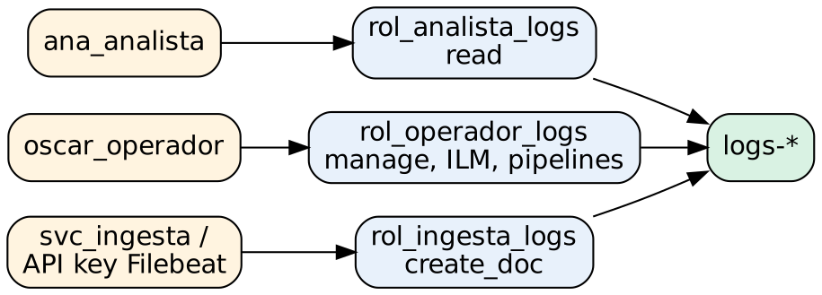

# Administración de Elasticsearch para gestión y análisis de logs

## Práctica 9. Crear usuarios y roles de mínimo privilegio para analistas, operadores y procesos de ingesta

### Objetivo

Al finalizar la práctica, serás capaz de:

- Verificar la seguridad por defecto de Elasticsearch 8.x: TLS, keystore, usuarios integrados y realms.
- Diseñar roles con privilegios de clúster, de índice y de Kibana siguiendo el principio de mínimo privilegio.
- Crear usuarios nativos y probar sus permisos.
- Sustituir la contraseña de `elastic` en Filebeat por una API key con privilegios limitados.
- Usar service accounts, seguridad a nivel de documento y de campo, auditoría y role mappings.

### Objetivo visual



### Duración aproximada

- 45 minutos.

### Prerrequisitos

- Prácticas 2 a 8 completadas.
- Licencia de prueba activa: la seguridad a nivel de documento y de campo y la auditoría no están incluidas en Basic.
- Una ventana de PowerShell con el entorno cargado (`. C:\labs\scripts\entorno.ps1`).

---

### Instrucciones

**Escenario:** hasta ahora todo se hizo con el superusuario `elastic`, que puede borrar cualquier índice, cambiar la configuración del clúster y leer todos los datos. Antes de abrir la plataforma al resto de la organización, debes crear accesos de mínimo privilegio para tres perfiles:

| Perfil | Necesita | No debe poder |
|---|---|---|
| **Analista** (NOC, soporte, auditoría) | Buscar logs y ver dashboards | Modificar índices, pipelines, dashboards o la configuración |
| **Operador** (administración diaria) | Administrar data streams, templates, pipelines, ILM y reglas; ver la salud del clúster | Administrar usuarios ni la seguridad |
| **Ingesta** (Filebeat, Logstash) | Escribir en sus data streams | Leer, borrar o escribir en otros índices |

---

### Tarea 1. Revisar la seguridad por defecto

#### Paso 1. Identifica con qué usuario y realm te autenticas

En **Dev Tools**:

```http
GET _security/_authenticate

GET _xpack/usage?filter_path=security.realms.native,security.realms.file,security.ssl
```

**Qué hace y por qué:** `_authenticate` muestra el usuario (`elastic`), sus roles (`superuser`) y el **realm** que lo validó (`reserved`, el realm de los usuarios integrados). Un **realm** es una fuente de autenticación. En 8.x vienen activos `native` (usuarios guardados en un índice del clúster) y `file` (usuarios en archivos de cada nodo). Se pueden agregar `ldap`, `active_directory`, `saml`, `oidc`, `pki` y `kerberos`. `_xpack/usage` confirma que TLS está activo en las capas HTTP y de transporte.

#### Paso 2. Revisa los certificados y el keystore

```http
GET _ssl/certificates?filter_path=*.path,*.subject_dn,*.expiry
```

En PowerShell (como administrador):

```powershell
cd C:\elastic\elasticsearch
.\bin\elasticsearch-keystore.bat list
```

**Qué hace y por qué:** `_ssl/certificates` lista los certificados en uso y su **fecha de expiración**. Un certificado vencido detiene la comunicación entre nodos y con los clientes, así que conviene vigilarlo. El **keystore** de Elasticsearch guarda cifrados los secretos que no deben estar en `elasticsearch.yml`, como las contraseñas de los archivos `.p12` (`xpack.security.http.ssl.keystore.secure_password`) y, en general, cualquier credencial de un repositorio de snapshots o de un realm LDAP.

#### Paso 3. Revisa los usuarios integrados

```http
GET _security/user?filter_path=*.username,*.roles,*.enabled
```

**Qué hace y por qué:** además de `elastic` existen usuarios integrados para componentes: `kibana_system`, `logstash_system`, `beats_system`, `apm_system` y `remote_monitoring_user`. En 8.x, Kibana ya no usa `kibana_system`, sino un **service account token** (Paso 15). Los usuarios integrados no pueden borrarse, pero sí desactivarse o cambiarles la contraseña.

---

### Tarea 2. Crear los roles

Un **rol** agrupa tres tipos de privilegios:

| Tipo | Ejemplos | Aplica a |
|---|---|---|
| De **clúster** | `monitor`, `manage_ilm`, `manage_index_templates`, `manage_pipeline`, `manage_security` | Operaciones sobre todo el clúster |
| De **índice** | `read`, `view_index_metadata`, `create_doc`, `auto_configure`, `monitor`, `manage`, `delete_index` | Índices, aliases y data streams que coinciden con `names` |
| De **Kibana** | Discover, Dashboard, Visualize Library, Maps, Rules… en nivel **Read** o **All**, por space | Funciones y spaces de Kibana |

#### Paso 4. Crea el rol de analista

```http
PUT _security/role/rol_analista_logs
{
  "description": "Consulta de logs y dashboards (solo lectura)",
  "cluster": [],
  "indices": [
    {
      "names": ["logs-*", "tienda-logs-*", "servicios-logs-lab"],
      "privileges": ["read", "view_index_metadata"]
    }
  ]
}
```

**Qué hace y por qué:** `read` permite buscar y agregar; `view_index_metadata` permite a Kibana leer los mappings para listar los campos en los data views. El analista no tiene privilegios de clúster. Un privilegio sobre un data stream (`logs-*`) se aplica también a sus backing indices.

#### Paso 5. Crea el rol de operador

```http
PUT _security/role/rol_operador_logs
{
  "description": "Administracion diaria de la plataforma de logs (sin seguridad)",
  "cluster": ["monitor", "manage_ilm", "manage_slm", "manage_index_templates", "manage_pipeline"],
  "indices": [
    {
      "names": ["logs-*", "tienda-logs-*", "servicios-logs-lab", "alertas-lab-logs"],
      "privileges": ["read", "view_index_metadata", "monitor", "manage"]
    }
  ]
}
```

**Qué hace y por qué:** el operador puede ver la salud del clúster (`monitor`) y administrar políticas ILM y SLM, templates y pipelines. Sobre los índices de logs puede leer y administrar (`manage` incluye rollover, cambio de settings y aliases). No recibe `manage_security` ni `all`: no puede crearse más privilegios a sí mismo.

#### Paso 6. Crea el rol de ingesta

```http
PUT _security/role/rol_ingesta_logs
{
  "description": "Escritura de Filebeat/Logstash en sus data streams",
  "cluster": ["monitor", "read_ilm", "read_pipeline"],
  "indices": [
    {
      "names": ["logs-weblab.*", "logs-syslog.*"],
      "privileges": ["create_doc", "auto_configure"]
    }
  ]
}
```

**Qué hace y por qué:** `create_doc` solo permite **agregar** documentos nuevos (no actualizar ni borrar), que es exactamente lo que necesita un data stream. `auto_configure` permite crear el data stream automáticamente la primera vez. Los privilegios de clúster `monitor`, `read_ilm` y `read_pipeline` los usan Filebeat y Logstash para verificar la conexión y la configuración. Un proceso de ingesta comprometido no podría leer ni borrar logs.

#### Paso 7. Agrega los privilegios de Kibana desde la interfaz

1. Ve a **Stack Management > Roles** y abre `rol_analista_logs`.
2. En **Kibana**, haz clic en **Add Kibana privilege**, elige los spaces **Default** y **Operaciones**, y selecciona **Customize**.
3. En **Analytics**, asigna **Read** a **Discover**, **Dashboard**, **Visualize Library** y **Maps**. Deja **None** en el resto.
4. Haz clic en **Add Kibana privilege** y en **Update role**.
5. Abre `rol_operador_logs` y agrega un privilegio para los mismos spaces: **All** en **Discover**, **Dashboard**, **Visualize Library** y **Maps**; en **Management**, **All** en **Stack Rules** y **Read** en **Stack Monitoring**. Haz clic en **Update role**.

**Qué hace y por qué:** los privilegios de Kibana controlan qué **aplicaciones** se ven y si se pueden crear o modificar objetos, por space. Son independientes de los privilegios de índice: un usuario con Discover en **All** pero sin `read` sobre `logs-*` vería Discover vacío. Se configuran en la interfaz porque los nombres internos de estos privilegios cambian entre versiones de Kibana.

---

### Tarea 3. Crear usuarios y probar el mínimo privilegio

#### Paso 8. Crea los usuarios nativos

```http
POST _security/user/ana_analista
{
  "password": "Analista.Lab2026",
  "roles": ["rol_analista_logs"],
  "full_name": "Ana Analista",
  "email": "ana.analista@ejemplo.mx"
}

POST _security/user/oscar_operador
{
  "password": "Operador.Lab2026",
  "roles": ["rol_operador_logs"],
  "full_name": "Oscar Operador"
}

POST _security/user/svc_ingesta
{
  "password": "Ingesta.Lab2026",
  "roles": ["rol_ingesta_logs"],
  "full_name": "Cuenta de servicio de ingesta",
  "metadata": { "tipo": "proceso" }
}
```

**Qué hace y por qué:** los usuarios del realm `native` se guardan en un índice del sistema y se replican en todo el clúster. Cada persona debe tener su propio usuario: compartir `elastic` impide saber quién hizo qué. En producción, las personas se autentican con LDAP, Active Directory o SAML (Tarea 6) y los procesos, con API keys.

#### Paso 9. Prueba los permisos de la analista con curl

En PowerShell:

```powershell
es GET "/_security/_authenticate?pretty" -User ana_analista -Password "Analista.Lab2026"
es GET "/logs-weblab.access-default/_count" -User ana_analista -Password "Analista.Lab2026"
es DELETE "/servicios-logs-lab" -User ana_analista -Password "Analista.Lab2026"
es GET "/_cluster/settings" -User ana_analista -Password "Analista.Lab2026"
```

**Qué hace y por qué:** la función `es` del script de entorno acepta otro usuario y contraseña. Resultados:

1. Usuario `ana_analista`, realm `default_native`, rol `rol_analista_logs`.
2. Conteo de **3,421**: puede leer logs.
3. Error **403** `security_exception`: *action [indices:admin/delete] is unauthorized for user [ana_analista]*. No puede borrar.
4. Error **403**: no tiene privilegios de clúster.

El 403 (*Forbidden*) significa que el usuario **sí** se autenticó, pero no tiene permiso; el 401 significa que no se autenticó.

#### Paso 10. Prueba la cuenta de ingesta

```powershell
@"
{"create":{}}
{"message":"$((Get-Date).ToString("yyyy-MM-dd'T'HH:mm:ss.fffzzz")) INFO [checkout-service] [srv-app01] [trace=-] [user=-] Prueba de escritura con svc_ingesta"}
"@ | Set-Content -Encoding ascii C:\labs\prueba_ingesta.ndjson

es POST "/logs-weblab.app-default/_bulk?filter_path=errors,items.*.status" -File C:\labs\prueba_ingesta.ndjson -User svc_ingesta -Password "Ingesta.Lab2026"
es POST "/servicios-logs-lab/_bulk?filter_path=errors,items.*.status,items.*.error.type" -File C:\labs\prueba_ingesta.ndjson -User svc_ingesta -Password "Ingesta.Lab2026"
es GET "/logs-weblab.app-default/_search?size=1" -User svc_ingesta -Password "Ingesta.Lab2026"
```

**Qué hace y por qué:**

1. Escribir en `logs-weblab.app-default` funciona (`status: 201`): el documento pasa por el pipeline `weblab-app` como cualquier otro.
2. Escribir en `servicios-logs-lab` falla con `status: 403` (`security_exception`).
3. Buscar falla con 403: la cuenta de ingesta **no puede leer** los logs que escribe.

#### Paso 11. Prueba los accesos en Kibana

1. Abre una ventana **privada** del navegador en `http://localhost:5601` e inicia sesión como `ana_analista`.
2. Verifica que el menú solo muestre Discover, Dashboard, Visualize Library y Maps; abre el dashboard `Operación tienda - Logs web` y confirma que **no** aparece el botón **Edit**.
3. Cierra sesión e ingresa como `oscar_operador`: puede editar dashboards, ver **Stack Management > Rules** e **Index Management**, pero no la sección **Security > Users**.

**Qué hace y por qué:** comprueba en la interfaz el mismo modelo que probaste con curl. Kibana aplica los privilegios de Kibana y Elasticsearch aplica los de índice y clúster en cada consulta, aunque el usuario intente saltarse la interfaz.

---

### Tarea 4. API keys y service accounts

#### Paso 12. Crea una API key para Filebeat

En **Dev Tools**:

```http
POST _security/api_key
{
  "name": "filebeat-weblab",
  "role_descriptors": {
    "filebeat_escritura": {
      "cluster": ["monitor", "read_ilm", "read_pipeline"],
      "indices": [
        { "names": ["logs-weblab.*"], "privileges": ["create_doc", "auto_configure"] }
      ]
    }
  },
  "metadata": { "servicio": "filebeat", "equipo": "operaciones" }
}
```

Copia los valores `id` y `api_key` de la respuesta.

**Qué hace y por qué:** los privilegios efectivos de una API key son la **intersección** de los privilegios de quien la crea (`elastic`) y los `role_descriptors` indicados, así que esta llave solo puede escribir en `logs-weblab.*`. Las API keys son la forma recomendada de autenticar procesos: no exponen la contraseña de ninguna persona, se pueden rotar y revocar individualmente, y aceptan expiración.

#### Paso 13. Configura Filebeat con la API key

1. Detén Filebeat con `Ctrl + C` en su ventana.
2. Edita `C:\elastic\filebeat\filebeat.yml`: comenta `username` y `password` y agrega `api_key` con el formato `id:api_key`:

```yaml
output.elasticsearch:
  hosts: ["https://localhost:9200"]
  #username: "elastic"
  #password: "${ES_PWD}"
  api_key: "<id>:<api_key>"
  ssl.certificate_authorities: ['C:\elastic\elasticsearch\config\certs\http_ca.crt']
```

3. Prueba y vuelve a ejecutar:

```powershell
cd C:\elastic\filebeat
.\filebeat.exe test output -c filebeat.yml
.\filebeat.exe -e -c filebeat.yml
```

**Qué hace y por qué:** Filebeat deja de usar al superusuario. Si alguien obtuviera el archivo de configuración, solo podría agregar documentos a los data streams `logs-weblab.*`. Filebeat no reenvía los logs ya leídos, porque su *registry* recuerda la posición de cada archivo. Para mayor seguridad, la API key también puede guardarse en el keystore de Filebeat.

#### Paso 14. Consulta e invalida API keys

```http
GET _security/api_key?name=filebeat-weblab&filter_path=api_keys.id,api_keys.name,api_keys.creation,api_keys.invalidated

POST _security/api_key
{ "name": "llave-temporal", "expiration": "1h" }

DELETE _security/api_key
{ "name": "llave-temporal" }
```

**Qué hace y por qué:** el inventario de API keys permite auditar qué procesos tienen acceso. Invalidar una llave corta el acceso de inmediato, por ejemplo, si un servidor se ve comprometido. La llave `reportes-programados-dashboard` de la Práctica 8b también aparece en el inventario.

#### Paso 15. Revisa los service accounts

```http
GET _security/service

GET _security/service/elastic/kibana/credential

POST _security/service/elastic/fleet-server/credential/token/token-lab
GET _security/service/elastic/fleet-server/credential
DELETE _security/service/elastic/fleet-server/credential/token/token-lab
```

**Qué hace y por qué:** los **service accounts** son cuentas predefinidas para componentes de Elastic (`elastic/kibana`, `elastic/fleet-server`, `elastic/enterprise-search-server`) con privilegios fijos que no se pueden modificar. Se autentican con **tokens**. El token de Kibana lo creó la inscripción de la Práctica 2. El token de `fleet-server` creado aquí es el que usaría un Fleet Server; se elimina al terminar porque no se usa.

---

### Tarea 5. Seguridad a nivel de documento y de campo, y auditoría

#### Paso 16. Crea un rol con seguridad a nivel de documento (DLS) y de campo (FLS)

```http
PUT _security/role/rol_analista_pagos
{
  "description": "Solo eventos de checkout y pagos, sin datos personales",
  "indices": [
    {
      "names": ["logs-weblab.app-*"],
      "privileges": ["read", "view_index_metadata"],
      "query": { "terms": { "service.name": ["checkout-service", "payment-service"] } },
      "field_security": {
        "grant": ["*"],
        "except": ["user.name", "source.*", "event.original"]
      }
    }
  ]
}

POST _security/user/pablo_pagos
{
  "password": "Pagos.Lab2026",
  "roles": ["rol_analista_pagos"],
  "full_name": "Pablo Pagos"
}
```

En PowerShell:

```powershell
es GET "/logs-weblab.app-default/_count" -User pablo_pagos -Password "Pagos.Lab2026"
es GET "/logs-weblab.app-default/_search?size=1&filter_path=hits.hits._source&q=log.level:ERROR" -User pablo_pagos -Password "Pagos.Lab2026"
```

**Qué hace y por qué:**

- **DLS** (`query`): el usuario solo ve los documentos que cumplen la consulta. El conteo es **672** (520 de checkout + 152 de payment), más los eventos simulados en la Práctica 8b y el de prueba del Paso 10, en lugar de los más de 2,458 del data stream.
- **FLS** (`field_security`): los campos `user.name`, `source.*` y `event.original` no aparecen en los resultados, ni siquiera en `_source`. Se excluye `event.original` porque contiene la línea completa, incluido el usuario.

Así un equipo puede analizar sus logs sin acceder a datos personales de clientes ni a eventos de otras áreas, en el mismo data stream.

#### Paso 17. Activa la auditoría

1. Edita `C:\elastic\elasticsearch\config\elasticsearch.yml` (como administrador) y agrega:

```yaml
xpack.security.audit.enabled: true
xpack.security.audit.logfile.events.include: ["authentication_failed", "access_denied", "security_config_change"]
```

2. Reinicia el servicio y espera a que responda:

```powershell
Restart-Service elasticsearch-service-x64
Start-Sleep -Seconds 40
es GET "/_cluster/health?pretty"
```

3. Genera eventos auditables:

```powershell
es GET "/_cluster/health" -User ana_analista -Password "contrasena-incorrecta"
es DELETE "/servicios-logs-lab" -User ana_analista -Password "Analista.Lab2026"
```

4. Revisa la bitácora:

```powershell
Get-Content C:\elastic\logs\lab-logs_audit.json -Tail 5
```

**Qué hace y por qué:** la auditoría registra en `<cluster.name>_audit.json`, en formato JSON, quién intentó qué, desde qué IP y con qué resultado. Verás un evento `authentication_failed` (contraseña incorrecta) y un `access_denied` (intento de borrado). Se limita a eventos relevantes porque auditar cada acceso permitido (`access_granted`) genera un volumen enorme. Ese archivo puede ingerirse con Filebeat para analizarlo como cualquier otro log.

> **Importante:** cambiar `elasticsearch.yml` requiere reiniciar el nodo. En un clúster de varios nodos se hace con un *rolling restart* (Práctica 11).

---

### Tarea 6. Otros realms y role mappings

#### Paso 18. Crea un usuario del realm `file` para emergencias

En PowerShell como administrador:

```powershell
cd C:\elastic\elasticsearch
.\bin\elasticsearch-users.bat useradd emergencia -p "Emergencia.Lab2026" -r superuser
.\bin\elasticsearch-users.bat list
es GET "/_security/_authenticate?filter_path=username,authentication_realm" -User emergencia -Password "Emergencia.Lab2026"
.\bin\elasticsearch-users.bat userdel emergencia
```

**Qué hace y por qué:** los usuarios del realm `file` se guardan en `config\users` y `config\users_roles` de **cada nodo** y no dependen de que el índice de seguridad esté disponible. Por eso se usan como **cuenta de emergencia** (*break glass*) cuando el realm nativo o el LDAP no funcionan. La desventaja es que hay que mantenerlos en todos los nodos. La autenticación muestra el realm `default_file`.

#### Paso 19. Revisa la configuración de LDAP/AD y SAML y crea un role mapping

Lee esta configuración de ejemplo para Active Directory (**no la apliques**: el laboratorio no tiene un controlador de dominio):

```yaml
xpack.security.authc.realms.active_directory.ad1:
  order: 1
  domain_name: ejemplo.mx
  url: ldaps://dc01.ejemplo.mx:636
  ssl.certificate_authorities: ["C:\\elastic\\elasticsearch\\config\\certs\\ca-corporativa.crt"]
  # La contrasena del usuario de enlace va en el keystore:
  # elasticsearch-keystore add xpack.security.authc.realms.active_directory.ad1.secure_bind_password
```

Crea el role mapping que asignaría el rol de analista a un grupo de AD:

```http
PUT _security/role_mapping/ad_analistas_logs
{
  "enabled": true,
  "roles": ["rol_analista_logs"],
  "rules": {
    "all": [
      { "field": { "realm.name": "ad1" } },
      { "field": { "groups": "CN=Analistas-Logs,OU=Grupos,DC=ejemplo,DC=mx" } }
    ]
  },
  "metadata": { "ticket": "CHG-5001" }
}

GET _security/role_mapping/ad_analistas_logs
```

**Qué hace y por qué:** con realms externos los usuarios no se crean en Elasticsearch: el **role mapping** asigna roles según los atributos del usuario autenticado (realm, grupos, nombre, DN). Así el alta y la baja de personal se administran en el directorio corporativo. SAML (y OIDC) se configura de forma parecida y habilita el inicio de sesión único en Kibana con el proveedor de identidad de la organización. El mapping queda creado, pero no tiene efecto mientras no exista el realm `ad1`.

---

### Resultado esperado

```http
GET _security/role/rol_*?filter_path=*.description
GET _security/user/ana_analista,oscar_operador,svc_ingesta,pablo_pagos?filter_path=*.username,*.roles
```

| Usuario o credencial | Rol | Prueba | Resultado |
|---|---|---|---|
| `ana_analista` | `rol_analista_logs` | Leer `logs-*` / borrar un índice / ver settings del clúster | 3,421 / 403 / 403 |
| `oscar_operador` | `rol_operador_logs` | Editar dashboards, ver reglas e Index Management | Permitido; sin acceso a Security |
| `svc_ingesta` | `rol_ingesta_logs` | Escribir en `logs-weblab.app-default` / en otro índice / leer | 201 / 403 / 403 |
| API key `filebeat-weblab` | descriptor `filebeat_escritura` | Filebeat envía logs | `test output` OK |
| `pablo_pagos` | `rol_analista_pagos` (DLS/FLS) | Conteo y campos visibles | 672 eventos originales (más los de prueba), sin `user.name` ni `source.*` |

- La bitácora `lab-logs_audit.json` contiene eventos `authentication_failed` y `access_denied`.
- Existe el role mapping `ad_analistas_logs`.

### Referencias

- Elastic. *Secure the Elastic Stack [8.19].* https://www.elastic.co/guide/en/elasticsearch/reference/8.19/secure-cluster.html
- Elastic. *Security privileges [8.19].* https://www.elastic.co/guide/en/elasticsearch/reference/8.19/security-privileges.html
- Elastic. *Kibana privileges [8.19].* https://www.elastic.co/guide/en/kibana/8.19/kibana-privileges.html
- Elastic. *API keys y Service accounts [8.19].* https://www.elastic.co/guide/en/elasticsearch/reference/8.19/service-accounts.html
- Elastic. *Document and field level security [8.19].* https://www.elastic.co/guide/en/elasticsearch/reference/8.19/field-and-document-access-control.html
- Elastic. *Auditing security settings [8.19].* https://www.elastic.co/guide/en/elasticsearch/reference/8.19/auditing-settings.html
- Elastic. *Role mapping [8.19].* https://www.elastic.co/guide/en/elasticsearch/reference/8.19/mapping-roles.html
