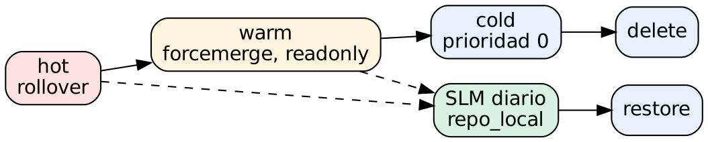

# Administración de Elasticsearch para gestión y análisis de logs

## Práctica 10. Configurar una política ILM de retención y una política SLM, y probar una restauración

### Objetivo

Al finalizar la práctica, serás capaz de:

- Diseñar una política de Index Lifecycle Management (ILM) con fases hot, warm, cold y delete, rollover, forcemerge y retención.
- Asociar la política a un data stream mediante un index template y observar el avance de las fases y la migración entre data tiers.
- Registrar un repositorio de snapshots en un sistema de archivos compartido (`path.repo`).
- Automatizar respaldos con Snapshot Lifecycle Management (SLM) y su retención.
- Restaurar un índice y un data stream, y comprobar la integridad de los datos.

### Objetivo visual



### Duración aproximada

- 50 minutos.

### Prerrequisitos

- Prácticas 5 a 9 completadas: data streams `logs-weblab.*` y `logs-syslog.lab-default`, e índices `servicios-logs-lab` y `tienda-logs-2026.10.20`.
- Script `C:\labs\scripts\cargar_ilmlab.ps1`.
- Permiso para reiniciar el servicio de Elasticsearch.

---

### Instrucciones

**Escenario:** la política de la empresa exige conservar los logs 30 días en almacenamiento rápido y después borrarlos, y tener un respaldo diario con 7 días de antigüedad, mínimo, para recuperarse de un borrado accidental. Primero probarás el ciclo completo con tiempos de **minutos**, para verlo funcionar durante la clase, y después aplicarás los tiempos reales.

> **Importante:** los tiempos en minutos (`3m`, `10m`) y el `poll_interval` de 10 segundos son **solo para el laboratorio**. En producción, las fases se miden en días y el `poll_interval` se deja en su valor por defecto (10 minutos).

---

### Tarea 1. Revisar el ciclo de vida actual

#### Paso 1. Revisa la política integrada `logs`

```http
GET _ilm/policy/logs

GET logs-weblab.access-default/_ilm/explain?filter_path=indices.*.policy,indices.*.phase,indices.*.action,indices.*.age
```

**Qué hace y por qué:** los data streams `logs-*-*` usan por defecto la política integrada `logs`, asignada por el component template `logs@settings`. Esa política hace **rollover** a los 30 días o a los 50 GB por shard primario, pero **no borra nada**: sin una política propia, los logs crecen indefinidamente hasta llenar el disco. `_ilm/explain` muestra en qué fase, acción y paso está cada backing index.

#### Paso 2. Acelera la evaluación de ILM para el laboratorio

```http
PUT _cluster/settings
{
  "persistent": { "indices.lifecycle.poll_interval": "10s" }
}
```

**Qué hace y por qué:** ILM revisa periódicamente si cada índice cumple las condiciones para avanzar; por defecto, cada 10 minutos. Con 10 segundos verás los cambios en clase. Lo restablecerás al final de la práctica.

---

### Tarea 2. Crear y aplicar una política ILM

#### Paso 3. Crea la política

```http
PUT _ilm/policy/lab-logs-retencion
{
  "policy": {
    "_meta": { "descripcion": "Politica de laboratorio con tiempos en minutos" },
    "phases": {
      "hot": {
        "min_age": "0ms",
        "actions": {
          "rollover": { "max_docs": 200, "max_age": "3m", "max_primary_shard_size": "50gb" },
          "set_priority": { "priority": 100 }
        }
      },
      "warm": {
        "min_age": "2m",
        "actions": {
          "forcemerge": { "max_num_segments": 1 },
          "readonly": {},
          "set_priority": { "priority": 50 }
        }
      },
      "cold": {
        "min_age": "5m",
        "actions": {
          "set_priority": { "priority": 0 }
        }
      },
      "delete": {
        "min_age": "10m",
        "actions": { "delete": {} }
      }
    }
  }
}
```

**Qué hace y por qué:**

| Fase | Cuándo entra | Acciones | Propósito |
|---|---|---|---|
| **hot** | Al crearse el índice | `rollover` al llegar a 200 documentos, 3 minutos o 50 GB por shard primario | Recibir escrituras; el rollover crea un backing index nuevo y mantiene los índices de tamaño manejable. |
| **warm** | 2 min después del rollover | `forcemerge` a 1 segmento, `readonly` | El índice ya no recibe escrituras; fusionar segmentos reduce el uso de disco y memoria y acelera las búsquedas. |
| **cold** | 5 min después del rollover | baja prioridad de recuperación | Datos consultados con poca frecuencia, en hardware más económico. |
| **delete** | 10 min después del rollover | `delete` | Cumplir la **retención**: borrar índices completos es inmediato y barato, a diferencia de borrar documentos. |

El `min_age` de cada fase se cuenta desde el **rollover** del índice, no desde su creación. `set_priority` define el orden de recuperación tras un reinicio: primero los índices hot. Las fases **warm** y **cold** incluyen de forma implícita la acción `migrate`, que mueve el índice al data tier correspondiente (Tarea 3). La fase **frozen** no se usa: requiere *searchable snapshots*, una función de licencia Enterprise.

#### Paso 4. Crea el index template que asocia la política al data stream

```http
PUT _index_template/logs-ilmlab
{
  "index_patterns": ["logs-ilmlab-*"],
  "data_stream": {},
  "priority": 200,
  "composed_of": ["logs@mappings", "logs@settings", "ecs@mappings"],
  "template": {
    "settings": {
      "index.lifecycle.name": "lab-logs-retencion",
      "index.number_of_replicas": 0
    }
  }
}
```

**Qué hace y por qué:** `index.lifecycle.name` en el template hace que **cada** backing index nuevo quede gobernado por la política. Sobrescribe la política `logs` que trae `logs@settings`. Asociar la política en el template, y no índice por índice, garantiza que el rollover herede la configuración.

#### Paso 5. Carga datos de forma continua

En una ventana de PowerShell aparte:

```powershell
. C:\labs\scripts\entorno.ps1
C:\labs\scripts\cargar_ilmlab.ps1 -Rondas 20 -DocsPorRonda 40 -PausaSeg 30
```

**Qué hace y por qué:** el script envía 40 documentos cada 30 segundos durante unos 10 minutos (800 en total) al data stream `logs-ilmlab-default`, que se crea automáticamente con el template del paso anterior. Con estos valores, el rollover ocurre cada 2.5 minutos por el límite de 200 documentos. Deja el script en ejecución y continúa.

#### Paso 6. Observa el rollover y el avance de las fases

Ejecuta estas peticiones varias veces, con un par de minutos entre una y otra:

```http
GET _data_stream/logs-ilmlab-default?filter_path=data_streams.indices.index_name,data_streams.generation,data_streams.ilm_policy

GET logs-ilmlab-default/_ilm/explain?filter_path=indices.*.phase,indices.*.action,indices.*.step,indices.*.age

GET _cat/indices/.ds-logs-ilmlab-*?v&h=index,health,docs.count,pri.store.size&s=index&expand_wildcards=all
```

**Qué hace y por qué:** verás cómo aumenta `generation` y aparecen backing indices nuevos (`-000002`, `-000003`…). Solo el último recibe escrituras (*write index*). En `_ilm/explain`, los anteriores avanzan de `hot` a `warm` (acción `forcemerge`), luego a `cold` y finalmente desaparecen en la fase `delete`. Si un índice se queda en un paso con `step: ERROR`, la respuesta incluye `step_info` con la causa, y se reintenta con `POST <indice>/_ilm/retry`.

#### Paso 7. Verifica el efecto de las acciones

Cuando algún índice esté en fase `warm` o posterior, ejecuta:

```http
GET _cat/segments/.ds-logs-ilmlab-*?v&h=index,segment,docs.count,size&expand_wildcards=all

GET .ds-logs-ilmlab-*/_settings?expand_wildcards=all&filter_path=**.routing.allocation.include._tier_preference,**.priority,**.blocks.write
```

**Qué hace y por qué:**

- Los índices en warm o cold tienen **un solo segmento** (efecto de `forcemerge`), mientras que el write index puede tener varios.
- `index.blocks.write: true` confirma que son de solo lectura.
- `_tier_preference` cambia de `data_hot` a `data_warm,data_hot` y después a `data_cold,data_warm,data_hot`: es la acción `migrate` indicando a qué nivel debe moverse el índice.
- `priority` baja de 100 a 50 y a 0.

---

### Tarea 3. Data tiers on premise

#### Paso 8. Revisa los roles de tier del nodo

```http
GET _cat/nodes?v&h=name,node.role

GET _cluster/allocation/explain
{
  "index": ".ds-logs-ilmlab-default-<fecha>-000001",
  "shard": 0,
  "primary": true
}
```

Sustituye el nombre por un backing index que exista (usa el resultado del Paso 6). Si todos ya se borraron, usa el más antiguo disponible.

**Qué hace y por qué:** el nodo tiene los roles `h` (hot), `w` (warm), `c` (cold) y `f` (frozen) a la vez, por lo que la migración entre tiers ocurre "en el mismo lugar": el índice cumple la preferencia sin moverse. En un clúster on premise real, los tiers se asignan a nodos con hardware distinto en `elasticsearch.yml`:

```yaml
# Nodos hot: SSD/NVMe, más CPU. Reciben escrituras y consultas recientes.
node.roles: [ data_hot, data_content, ingest ]

# Nodos warm: discos más grandes y económicos.
node.roles: [ data_warm ]

# Nodos cold: almacenamiento de gran capacidad; menos réplicas.
node.roles: [ data_cold ]

# Nodos maestros dedicados (3 para quórum), sin datos.
node.roles: [ master ]
```

Con esa configuración, la acción `migrate` de ILM mueve los shards de un tipo de nodo a otro sin intervención manual, y `allocation explain` muestra el decider `data_tier`.

---

### Tarea 4. Aplicar la retención real a los logs de la tienda

#### Paso 9. Crea la política de producción y aplícala

```http
PUT _ilm/policy/logs-tienda-30d
{
  "policy": {
    "phases": {
      "hot":    { "actions": { "rollover": { "max_age": "1d", "max_primary_shard_size": "50gb" } } },
      "warm":   { "min_age": "7d",  "actions": { "forcemerge": { "max_num_segments": 1 }, "set_priority": { "priority": 50 } } },
      "delete": { "min_age": "30d", "actions": { "delete": {} } }
    }
  }
}

PUT logs-weblab.access-default,logs-weblab.app-default,logs-syslog.lab-default/_settings
{
  "index.lifecycle.name": "logs-tienda-30d"
}

GET logs-weblab.*,logs-syslog.*/_ilm/explain?filter_path=indices.*.policy,indices.*.phase
```

**Qué hace y por qué:** cambiar `index.lifecycle.name` en los data streams actualiza sus backing indices **actuales**. Para que los **futuros** backing indices también la usen, agrega la misma línea en los templates `logs-weblab.access` y `logs-weblab.app` (en `template.settings`), o crea el component template `logs@custom`, que el template integrado `logs` incluye automáticamente. Con esta política, cada día se crea un índice nuevo, a los 7 días se compacta y a los 30 días se borra. El rollover diario hace que la retención sea precisa: se borra un día completo a la vez.

---

### Tarea 5. Repositorio de snapshots

#### Paso 10. Declara la ruta del repositorio en `path.repo`

En PowerShell como administrador:

```powershell
New-Item -ItemType Directory -Force -Path C:\elastic\respaldos
notepad C:\elastic\elasticsearch\config\elasticsearch.yml
```

Agrega al final y guarda:

```yaml
path.repo: ["C:\\elastic\\respaldos"]
```

Reinicia el servicio:

```powershell
Restart-Service elasticsearch-service-x64
Start-Sleep -Seconds 40
es GET "/_cluster/health?pretty"
```

**Qué hace y por qué:** por seguridad, Elasticsearch solo permite repositorios de tipo `fs` dentro de las rutas listadas en `path.repo`, que es un setting **estático** y requiere reiniciar. En un clúster de varios nodos, la ruta debe ser un **almacenamiento compartido** montado en el mismo lugar en **todos** los nodos maestros y de datos: un recurso NFS en Linux o una ruta UNC en Windows (`\\servidor\respaldos`, que en el YAML se escribe `path.repo: ["\\\\servidor\\respaldos"]`), accesible para la cuenta con la que corre el servicio. Un disco local solo sirve para un nodo único como este.

#### Paso 11. Registra y verifica el repositorio

```http
PUT _snapshot/repo_local
{
  "type": "fs",
  "settings": {
    "location": "repo_local",
    "compress": true
  }
}

POST _snapshot/repo_local/_verify
```

**Qué hace y por qué:** `location` relativa se resuelve dentro de `path.repo` (`C:\elastic\respaldos\repo_local`). `compress: true` comprime los metadatos. `_verify` comprueba que cada nodo puede escribir en el repositorio; en un clúster real detecta un nodo que no montó el recurso compartido. La respuesta lista el nodo `nodo-01`.

> **Alternativa S3 compatible on premise (MinIO, Ceph, etc.):** se agregan las credenciales al keystore (`elasticsearch-keystore add s3.client.minio.access_key` y `s3.client.minio.secret_key`), se configura el cliente en `elasticsearch.yml` (`s3.client.minio.endpoint: "minio.ejemplo.local:9000"`, `s3.client.minio.protocol: https`, `s3.client.minio.path_style_access: true`) y se registra el repositorio con `"type": "s3"` y `"settings": { "bucket": "respaldos-elastic", "client": "minio", "base_path": "lab-logs" }`. El plugin `repository-s3` viene incluido en 8.x.

#### Paso 12. Toma un snapshot manual

```http
PUT _snapshot/repo_local/snap-manual-1?wait_for_completion=true
{
  "indices": "servicios-logs-lab,tienda-logs-*,logs-weblab.*,logs-syslog.*",
  "include_global_state": false,
  "metadata": { "motivo": "Practica 10 - respaldo antes de pruebas de restauracion" }
}

GET _cat/snapshots/repo_local?v&h=id,status,indices,successful_shards,failed_shards,duration
```

**Qué hace y por qué:** el snapshot copia los segmentos de los índices y data streams indicados. Es **incremental**: un segundo snapshot solo copia los segmentos nuevos, por eso los respaldos frecuentes son baratos. Por la misma razón, los índices ya compactados con `forcemerge` se respaldan una sola vez. `include_global_state: false` excluye la configuración del clúster (templates, políticas, usuarios); inclúyela en un respaldo aparte si la necesitas. El estado debe ser `SUCCESS`.

---

### Tarea 6. Automatizar con SLM

#### Paso 13. Crea la política SLM

```http
PUT _slm/policy/slm-logs-diario
{
  "schedule": "0 30 1 * * ?",
  "name": "<logs-diario-{now/d}>",
  "repository": "repo_local",
  "config": {
    "indices": ["logs-*", "tienda-logs-*", "servicios-logs-lab"],
    "include_global_state": false,
    "ignore_unavailable": true
  },
  "retention": {
    "expire_after": "7d",
    "min_count": 2,
    "max_count": 10
  }
}
```

**Qué hace y por qué:**

- `schedule` usa sintaxis cron de Elasticsearch (con segundos): todos los días a la 01:30 UTC.
- `name` usa *date math* y produce nombres como `logs-diario-2026.10.21-<id>`.
- `retention` borra los snapshots con más de 7 días, pero siempre conserva al menos 2 (para no quedarse sin respaldos si fallan varios días seguidos) y nunca más de 10.

Así se cumplen el respaldo diario y la retención mínima de 7 días del escenario.

#### Paso 14. Ejecuta la política de inmediato y revisa su estado

```http
POST _slm/policy/slm-logs-diario/_execute

GET _slm/policy/slm-logs-diario?human&filter_path=*.last_success,*.last_failure,*.next_execution,*.stats

GET _cat/snapshots/repo_local?v&h=id,status,indices,duration

GET _slm/stats
```

**Qué hace y por qué:** `_execute` dispara la política sin esperar al horario, una buena práctica después de crearla o modificarla. `last_success`, `next_execution` y las estadísticas permiten vigilar que los respaldos se ejecutan. En producción conviene crear una alerta si `last_failure` es más reciente que `last_success`. También puedes administrar las políticas en **Stack Management > Snapshot and Restore**.

---

### Tarea 7. Probar la restauración

Un respaldo que nunca se ha restaurado no es un respaldo comprobado.

#### Paso 15. Restaura un índice con otro nombre

```http
POST _snapshot/repo_local/snap-manual-1/_restore?wait_for_completion=true
{
  "indices": "servicios-logs-lab",
  "rename_pattern": "(.+)",
  "rename_replacement": "restaurado-$1",
  "include_aliases": false
}

GET restaurado-servicios-logs-lab/_count
GET servicios-logs-lab/_count
```

**Qué hace y por qué:** restaurar con otro nombre permite recuperar datos **junto** al índice actual, por ejemplo, para comparar o rescatar documentos borrados por error, sin sobrescribir nada. Ambos conteos deben ser **3,489**.

#### Paso 16. Simula una pérdida y restaura el índice original

```http
DELETE servicios-logs-lab

GET servicios-logs-lab/_count

POST _snapshot/repo_local/snap-manual-1/_restore?wait_for_completion=true
{
  "indices": "servicios-logs-lab"
}

GET servicios-logs-lab/_count

GET servicios-logs-lab/_search
{
  "size": 0,
  "aggs": { "por_servicio": { "terms": { "field": "service.name" } } }
}
```

**Qué hace y por qué:** después del `DELETE`, la consulta responde `index_not_found_exception`. Tras restaurar, el índice vuelve con **3,489** documentos y la agregación por servicio coincide con la Práctica 6 (catalog 1,318, cart 563, …). Un índice no puede restaurarse sobre otro abierto con el mismo nombre: primero se borra o se cierra.

#### Paso 17. Restaura un data stream completo

```http
DELETE _data_stream/logs-syslog.lab-default

POST _snapshot/repo_local/snap-manual-1/_restore?wait_for_completion=true
{
  "indices": "logs-syslog.lab-default",
  "include_global_state": false
}

GET _data_stream/logs-syslog.lab-default?filter_path=data_streams.name,data_streams.indices.index_name,data_streams.status
GET logs-syslog.lab-default/_count
```

**Qué hace y por qué:** al restaurar un data stream se recuperan sus backing indices y su definición. El conteo vuelve a ser **663**. Para que el data stream siga recibiendo datos después de restaurarlo, su index template debe existir en el clúster; aquí se usa el template integrado `logs`.

#### Paso 18. Restablece los valores de laboratorio y limpia

```http
PUT _cluster/settings
{
  "persistent": { "indices.lifecycle.poll_interval": null }
}

DELETE restaurado-servicios-logs-lab
DELETE _data_stream/logs-ilmlab-default
```

**Qué hace y por qué:** `null` regresa el setting a su valor por defecto. Se borran el índice restaurado de prueba y el data stream de laboratorio. Conserva el repositorio, la política SLM y la política `logs-tienda-30d`.

---

### Resultado esperado

- Durante la carga, `logs-ilmlab-default` llegó a tener varias generaciones, sus backing indices recorrieron las fases **hot → warm → cold → delete** y los primeros se borraron automáticamente.
- En warm, los índices quedaron con 1 segmento, `blocks.write: true` y `_tier_preference: data_warm,data_hot`.
- Los data streams de la tienda usan la política `logs-tienda-30d`.
- Repositorio `repo_local` verificado y snapshots `SUCCESS`:

```text
id                                status  indices
snap-manual-1                     SUCCESS 9
logs-diario-2026.10.21-xxxxxxxxxx SUCCESS 9
```

(El número de índices puede variar según los backing indices existentes).

- Las restauraciones devolvieron **3,489** documentos para `servicios-logs-lab` (con otro nombre y con el original) y **663** para `logs-syslog.lab-default`.

### Referencias

- Elastic. *ILM: Manage the index lifecycle [8.19].* https://www.elastic.co/guide/en/elasticsearch/reference/8.19/index-lifecycle-management.html
- Elastic. *Index lifecycle actions [8.19].* https://www.elastic.co/guide/en/elasticsearch/reference/8.19/ilm-actions.html
- Elastic. *Data tiers [8.19].* https://www.elastic.co/guide/en/elasticsearch/reference/8.19/data-tiers.html
- Elastic. *Snapshot and restore [8.19].* https://www.elastic.co/guide/en/elasticsearch/reference/8.19/snapshot-restore.html
- Elastic. *Shared file system repository [8.19].* https://www.elastic.co/guide/en/elasticsearch/reference/8.19/snapshots-filesystem-repository.html
- Elastic. *S3 repository [8.19].* https://www.elastic.co/guide/en/elasticsearch/reference/8.19/repository-s3.html
- Elastic. *Automate snapshots with SLM [8.19].* https://www.elastic.co/guide/en/elasticsearch/reference/8.19/automate-snapshots-slm.html
